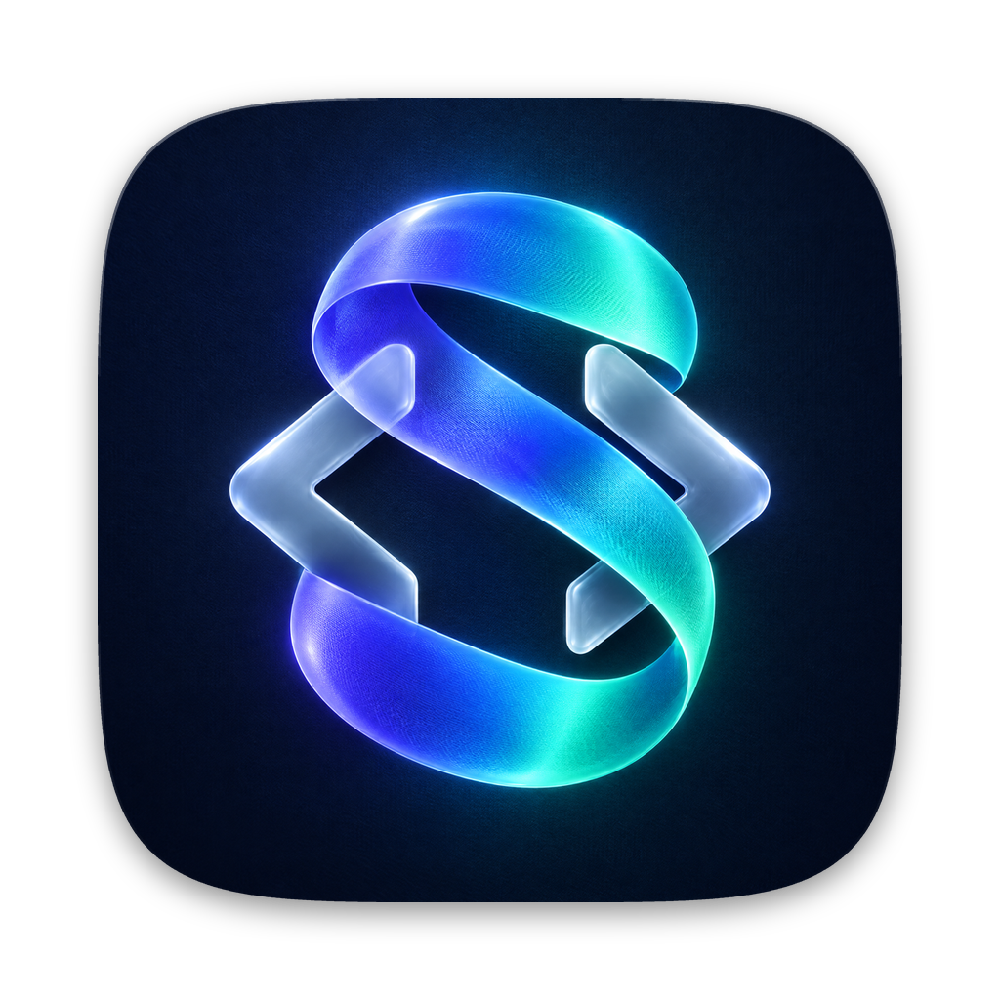
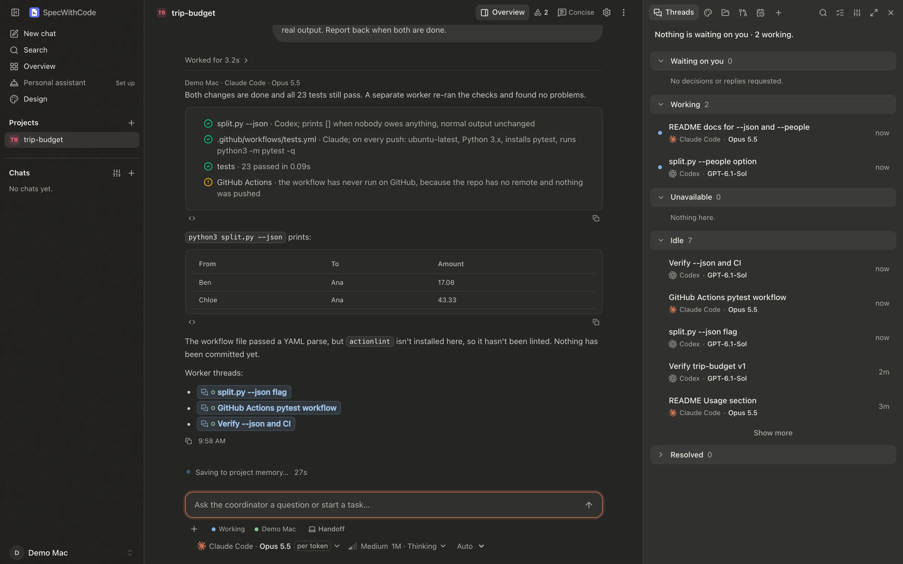
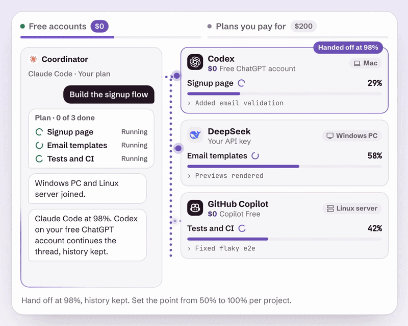

<p align="center">
  
</p>

<h1 align="center">SpecWithCode</h1>

<p align="center"><b>One desktop app for Claude Code, Codex, Copilot and your other coding agents.</b><br/>Run tasks side by side on your own machines. Set a fallback so another provider can continue when one hits its limit.</p>

<p align="center">Free and open source under MIT. Bring your own provider accounts or API keys.</p>

<p align="center">
  
  <br/><sub>Real app, demonstration project. <a href="https://specwithcode.com/?utm_source=github&utm_medium=readme&utm_campaign=stars-nov26">Watch the demo</a>.</sub>
</p>

## Try it

**Desktop:** download the [macOS, Windows or Linux app](https://github.com/anton-abyzov/specwithcode/releases/latest), open it, then connect a coding agent you already use.

**One-command server install** on an Apple silicon Mac or Linux (x64 or arm64, glibc and systemd required on Linux):

```sh
curl -fsSL https://github.com/anton-abyzov/specwithcode/releases/latest/download/install.sh | bash
```

This installs the local server and starts its background service, not the desktop app. [Read what the installer does](docs/user/install.md#command-line) before running it. Windows users should use the desktop installer. You need an installed, signed-in coding agent to start work.

**First task:** open a project folder, choose your provider and model, and ask for one small change you can review.

If this is useful for your workflow, [star SpecWithCode on GitHub](https://github.com/anton-abyzov/specwithcode) so you can find it again.

<p align="center">
  <a href="https://github.com/anton-abyzov/specwithcode/releases/latest/download/SpecWithCode-arm64.dmg"></a>
  <a href="https://github.com/anton-abyzov/specwithcode/releases/latest"></a>
  <a href="https://github.com/anton-abyzov/specwithcode/releases/latest"></a>
</p>

<p align="center">
  <a href="https://github.com/anton-abyzov/specwithcode/stargazers"></a>
  <a href="LICENSE"></a>
  <a href="https://github.com/anton-abyzov/specwithcode/releases/latest"></a>
  <a href="https://specwithcode.com/?utm_source=github&utm_medium=readme&utm_campaign=stars-nov26"></a>
</p>

<details>
<summary>See an illustrated multi-machine workflow</summary>

<p align="center">
  
  <br/><sub>Illustration of the flow, 25 s loop (<a href="assets/readme/hero-loop.mp4">MP4</a>). <a href="assets/readme/app-window.webp">Screenshot of the real app</a> · <a href="https://specwithcode.com/?utm_source=github&utm_medium=readme&utm_campaign=stars-nov26">longer demo on the site</a></sub>
</p>

</details>

## Why

You already pay for Claude Code, Codex or Copilot. SpecWithCode is one free, open-source (MIT) window that runs them together:

- **Parallel agents, one conversation.** Give a goal to a coordinator. It splits the work into worker threads, each on its own provider, model and git worktree, and reports back. You review pull requests, not chat logs.
- **Never stuck on a limit.** Every account's usage on one screen. When a provider runs out, a per-project rule moves the thread to another provider with its recent history, waits for the reset, or asks you.
- **All your machines.** Pair a Linux box or a Windows PC over your network, SSH or Tailscale. Workers run where the code and the sign-ins already are.
- **The spec lives in git.** What was asked, what counts as done and the proof are files in your repo ([SpecWeave](https://github.com/anton-abyzov/specweave), MIT), so any agent can continue the work.

Free, no account, bring your own subscriptions or API keys. SpecWithCode sells no inference and adds no markup. If it saves you time, a ⭐ helps other developers find it.

## Compared with what you use today

| | One agent's own app | tmux and worktrees by hand | Cloud agents | **SpecWithCode** |
|---|---|---|---|---|
| Claude Code, Codex, Copilot and more in one window | One vendor | Yes, many terminals | One vendor | **Yes** |
| A coordinator splits one goal into parallel tasks | Within one vendor | You do it | Within one vendor | **Yes, across vendors** |
| Continues on another provider when one hits its limit | No | You re-explain the task | No | **Yes, history kept** |
| Runs on your own machines and sign-ins | Yes, one machine | Yes | No, vendor cloud | **Yes, Mac, Linux and Windows** |
| Plan and evidence saved in your repo | No | Only if you write it | No | **Yes, spec in git** |
| Price | Your plan | Free | Your plan | **Free, MIT** |

## What it does

| Instead of                              | In SpecWithCode                                                                                                                                                                                                           |
| --------------------------------------- | ------------------------------------------------------------------------------------------------------------------------------------------------------------------------------------------------------------------------- |
| Claude Code Projects, Codex cloud tasks | **Projects**: a coordinator splits a goal into tasks and hands them to workers, each on its own provider and model. Memory, a plan and verified tasks per project.                                                        |
| One app per lab                         | **Every official agent** in one window, each with its own sign-in, approvals and limits. Switch a thread to another provider mid-conversation and the recent conversation carries over.                                   |
| Waiting for a usage reset               | **Usage limits** for every account on one screen. When a provider runs out, a per-project rule offers another provider, waits for the reset or switches on its own.                                                       |
| OpenAI Dots, Hermes, OpenClaw           | **Personal projects** with their own folder, memory and scheduled routines; local MCP tools granted one by one; a Telegram channel to the coordinator through your own bot; optional read-only Gmail, Calendar and Drive. |
| A cloud container                       | **Your machines**. Work runs where your code, skills and folders already are. Pair more machines over your local network, an SSH tunnel or Tailscale.                                                                     |
| Memory locked in one vendor             | **The record in git**. Specs, task evidence and handoffs are files any tool can continue from with `specweave pickup`.                                                                                                    |

SpecWithCode is not a cloud service: work runs on the machine you choose and stops when it sleeps.

## Built with itself

SpecWithCode is developed in SpecWithCode. A coordinator thread holds each feature's brief, worker threads on Claude Code, Codex and Copilot write the change in their own worktrees and open the pull request, and the spec, acceptance criteria and task evidence are committed as SpecWeave increments. The numbers, from October 9 to November 7, 2026:

| | Count | Where to check |
|---|---|---|
| SpecWithCode increments (spec.md, numbered acceptance criteria, task ledger) | **302**, 215 completed | [`.specweave/increments`](https://github.com/anton-abyzov/specweave-umb/tree/main/.specweave/increments) in the public planning repo, e.g. [thread handoff mode](https://github.com/anton-abyzov/specweave-umb/tree/main/.specweave/increments/0967-thread-handoff-mode) and [subscription change recovery](https://github.com/anton-abyzov/specweave-umb/tree/main/.specweave/increments/1071-same-cli-subscription-change-recovery) |
| Pull requests merged into the app | **1,393**, including 169 release PRs | the development repository, private until the MIT switch on November 7; new work lands as public pull requests [here](https://github.com/anton-abyzov/specwithcode/pulls) |
| Of those, linked in the app's own records to a SpecWithCode worker thread on the main Mac | **at least 418**, from 204 threads: 278 Claude Code, 127 Codex, 13 GitHub Copilot | thread records on that machine |
| Machines | a Mac and a Linux server, paired over SpecWithCode Connect | [handoff end-to-end test](https://specwithcode.com/?utm_source=github&utm_medium=readme&utm_campaign=stars-nov26#built-with-itself) |

The 418 is a floor, not the total: PRs from threads on the Linux worker, threads deleted since, and release automation are not in that count, and some changes were made outside the app.

## Install

1. Download [SpecWithCode-arm64.dmg](https://github.com/anton-abyzov/specwithcode/releases/latest/download/SpecWithCode-arm64.dmg), the latest release (all versions are on [Releases](https://github.com/anton-abyzov/specwithcode/releases)). It runs on Apple silicon Macs with macOS 13 or later. Installers for Windows 10 and 11 (x64 and arm64) and Linux (x64 and arm64, AppImage and .deb) are added to the same release about 20 minutes after the Mac app; take them from the [latest release](https://github.com/anton-abyzov/specwithcode/releases/latest). They are not code-signed yet, so check them against `SHA256SUMS-windows-linux`. Intel Macs are not supported.
2. Drag **SpecWithCode** to Applications. Releases are signed with an Apple Developer ID and notarized, so the app opens without a security override. An install from before 1.0.0, named SpecWeave Studio (Alpha), renames itself to SpecWithCode when it updates and keeps its settings and sign-ins.
3. Install and sign in to at least one coding agent (for example Claude Code or Codex). You also need git, which comes with the Xcode Command Line Tools.

The app updates itself from this repository's releases. Turn that off in **Settings → About**, or set `SPECWITHCODE_DISABLE_AUTO_UPDATE=true` (the older `STUDIO_DISABLE_AUTO_UPDATE` is still accepted).

More: [install](docs/user/install.md), [first run](docs/user/welcome-wizard.md), [providers](docs/user/providers-claude.md), [remote access](docs/user/remote-access.md), [outside agents over MCP](docs/user/outside-agents.md), [your own VPS](docs/user/linux-worker.md), [updating](docs/user/updating.md).

In **Settings > Providers**, a CLI's update action opens a machine selection plan. Choose only this CLI here, or explicitly include eligible connected machines. The app uses each configured executable's owning installer and reports each outcome; see [provider updates](docs/user/updating.md#provider-clis).

To connect Copilot, Grok or Gemini, use **Add or manage providers** in the model picker. [Provider setup](docs/studio/copilot-and-grok.md) explains installation, sign-in and model discovery; a connected usage source only reports quota.

## Use it

The composer’s access selector also controls a provider’s **Allow All** setting. **Full access** enables it; all other access modes disable it. Agent mode and reasoning remain in the model-options menu. If the provider cannot confirm the permission change, the turn stops with an error.

- **Start a thread**: pick a folder, a provider and a model, and talk to the agent. Plans, approvals, steering, queued turns and git checkpoints work as in the agent's own app.
- **Start a project** when the work is bigger than one thread: give it a goal and let the coordinator hand tasks to workers. See [project orchestration](docs/studio/project-orchestration.md).
- **Add a machine**: run SpecWithCode on it, then pair it. Being reachable is not permission; every machine and browser is paired separately. To pair a browser:

  ```sh
  specwithcode auth pairing create --ttl 5m --label "My laptop" --base-url http://127.0.0.1:8319
  ```

  The output is a credential. Keep it out of chat and screenshots.

The local service listens on `http://127.0.0.1:8319/` and keeps its data in `~/.specwithcode`; installs that started before that default keep using `~/.specweave-studio`. The command line tool is `specwithcode`, also installed under its original name `specweave-studio`.

Projects keep their coordinator in the main pane, with workers beside it. For short replies, use **Settings → Agents → Response style → Concise**. If the coordinator's model is unavailable, open its model picker to **Check again**, choose another model, or open setup for that machine; checking availability does not resend your message.

The unreleased [project handoff model](docs/studio/logical-projects.md) keeps one named project and coordinator window across explicitly linked machines. Threads retain their execution machine and recorded model; earlier coordinator segments remain readable. Handoffs start a fresh provider session, and unreachable machines can have history that is temporarily unavailable. Existing independent projects require explicit association.

## Details

Automatic fallback requires an explicit configured choice before selecting ACP agents whose billing is unknown. See [when a provider runs out](docs/user/usage.md#when-a-provider-runs-out).

HTML reports open from a compact preview into a focused reader. The conversation stays available through Show thread. See the [report experience](docs/reports/report-experience.md) for behavior and compatibility limits.

Settings > Skills manages versions and agent visibility. Claude plugin skills use the whole-plugin control; disabled plugins stay visible so you can turn them back on or Undo. Version updates require a fresh preview if the registry changes before confirmation.

**Settings → Connections** includes a read-only [MCP connections library](docs/connections-library.md) for Codex and Claude Code on each machine. Project **Environment** adds project declarations and overrides alongside SpecWithCode-managed tool grants. Configuration is shown separately from unverified authentication and session availability.

The model picker distinguishes the coding harness from the model and its billing source. See the [harness integration guide](docs/providers/harnesses.md) for OpenCode, Pi, native adapters and verification limits.

## Privacy

Folders, sessions and project data stay on your machine. Telemetry and the hosted relay are off by default. Model calls go to the providers you choose, as they would from your terminal. See [security boundaries](docs/studio/security.md) and [telemetry](docs/user/telemetry.md).

## Build from source

Node 22.20 or later and pnpm 11.

```sh
pnpm install --frozen-lockfile
pnpm dev            # server and web app
pnpm dev:desktop    # desktop app
```

For app-only work (most lanes), `pnpm run install:lane` installs everything except
`infra/relay` — it skips the Alchemy/Cloudflare deploy toolchain (≈2 GiB of packages).
Add the relay later with `pnpm run install:relay`. In an existing full checkout, run
`pnpm run clean` first: pnpm will not shrink an already-linked tree on a scope switch.
Release and CI always run the full install.

Contributor notes, architecture and focused checks are in [AGENTS.md](AGENTS.md).

## Status

Early access. Projects, providers, usage limits, machines, routines and the Telegram and Google connections are in the current build and in daily use. Live project runs are recorded with Codex and Claude Code; Grok Build and OpenCode have tutorial runs; Cursor and Antigravity workers have no recorded project run yet. See the [changelog](CHANGELOG.md).

## Contributing

Contributions are welcome. Start with an issue labelled [good first issue](https://github.com/anton-abyzov/specwithcode/labels/good%20first%20issue), read [CONTRIBUTING.md](CONTRIBUTING.md) and the [code of conduct](CODE_OF_CONDUCT.md), and share ideas in [Discussions](https://github.com/anton-abyzov/specwithcode/discussions/categories/ideas).

## License

SpecWithCode is open source under the [MIT License](LICENSE). Third-party code and assets keep their own licenses and notices in [THIRD_PARTY_NOTICES.md](THIRD_PARTY_NOTICES.md).

For umbrella projects with nested repositories, see [project transfer choices](docs/user/add-a-machine.md#projects-in-an-umbrella-folder).
