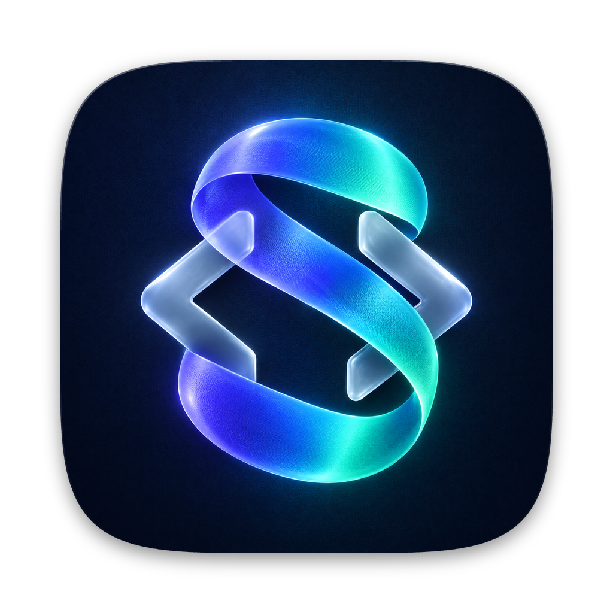

# SpecWithCode

**Write the spec. Get the code.**

SpecWithCode is a free desktop workspace for the coding agents you already pay for. Run Claude Code, Codex, Grok Build, Cursor, OpenCode, Copilot, Antigravity and Pi side by side on your own machines. Every change an agent makes lands with its spec: what was asked, what counts as done and the proof, in the same repo as the code, so any agent on any machine can pick it up.

It is built on [SpecWeave](https://github.com/anton-abyzov/specweave), the open-source CLI (`npm install -g specweave`) that keeps that record in git. Website: [spec-weave.com/studio](https://spec-weave.com/studio).

Free for every developer and team, MIT licensed, no account. You bring your own provider subscriptions or API keys; SpecWithCode supplies no inference, resells no tokens and charges no seat fee to run agents on your own machines. What is free today stays free; companies can pay for hosted private skills and enterprise support ([pricing](https://spec-weave.com/pricing)).

## What it does

| Instead of                              | In SpecWithCode                                                                                                                                                                                                           |
| --------------------------------------- | ------------------------------------------------------------------------------------------------------------------------------------------------------------------------------------------------------------------------- |
| Claude Code Projects, Codex cloud tasks | **Projects**: a coordinator splits a goal into tasks and hands them to workers, each on its own provider and model. Memory, a plan and verified tasks per project.                                                        |
| One app per lab                         | **Every official agent** in one window, each with its own sign-in, approvals and limits. Switch a thread to another provider mid-conversation and the recent conversation carries over.                                   |
| Waiting for a usage reset               | **Usage limits** for every account on one screen. When a provider runs out, a per-project rule offers another provider, waits for the reset or switches on its own.                                                       |
| OpenAI Dots, Hermes, OpenClaw           | **Personal projects** with their own folder, memory and scheduled routines; local MCP tools granted one by one; a Telegram channel to the coordinator through your own bot; optional read-only Gmail, Calendar and Drive. |
| A cloud container                       | **Your machines**. Work runs where your code, skills and folders already are. Pair more machines over your local network, an SSH tunnel or Tailscale.                                                                     |
| Memory locked in one vendor             | **The record in git**. Specs, task evidence and handoffs are files any tool can continue from with `specweave pickup`.                                                                                                    |

SpecWithCode is not a cloud service: work runs on the machine you choose and stops when it sleeps.

## Install

1. Download [SpecWithCode-arm64.dmg](https://github.com/anton-abyzov/specwithcode/releases/latest/download/SpecWithCode-arm64.dmg), the latest release (all versions are on [Releases](https://github.com/anton-abyzov/specwithcode/releases)). It runs on Apple silicon Macs with macOS 13 or later. Windows and Intel Macs are not built yet.
2. Drag **SpecWithCode** to Applications. An install from before 1.0.0, named SpecWeave Studio (Alpha), renames itself to SpecWithCode when it updates and keeps its settings and sign-ins.
3. The build is not notarized yet. On first launch, open **System Settings → Privacy & Security** and choose **Open Anyway**.
4. Install and sign in to at least one coding agent (for example Claude Code or Codex). You also need git, which comes with the Xcode Command Line Tools.

The app updates itself from this repository's releases. Turn that off in **Settings → About**, or set `STUDIO_DISABLE_AUTO_UPDATE=true`.

More: [install](docs/user/install.md), [first run](docs/user/welcome-wizard.md), [providers](docs/user/providers-claude.md), [remote access](docs/user/remote-access.md), [updating](docs/user/updating.md).

To connect Copilot, Grok or Gemini, use **Add or manage providers** in the model picker. [Provider setup](docs/studio/copilot-and-grok.md) explains installation, sign-in and model discovery; a connected usage source only reports quota.

## Use it

- **Start a thread**: pick a folder, a provider and a model, and talk to the agent. Plans, approvals, steering, queued turns and git checkpoints work as in the agent's own app.
- **Start a project** when the work is bigger than one thread: give it a goal and let the coordinator hand tasks to workers. See [project orchestration](docs/studio/project-orchestration.md).
- **Add a machine**: run SpecWithCode on it, then pair it. Being reachable is not permission; every machine and browser is paired separately. To pair a browser:

  ```sh
  specweave-studio auth pairing create --ttl 5m --label "My laptop" --base-url http://127.0.0.1:8319
  ```

  The output is a credential. Keep it out of chat and screenshots.

The local service listens on `http://127.0.0.1:8319/` and keeps its data in `~/.specweave-studio`. The command line tool is `specweave-studio`, also installed as `specwithcode`.

Projects keep their coordinator in the main pane, with workers beside it. For short replies, use **Settings → Agents → Response style → Concise**. If the coordinator's model is unavailable, open its model picker to **Check again**, choose another model, or open setup for that machine; checking availability does not resend your message.

## Privacy

Folders, sessions and project data stay on your machine. Telemetry and the hosted relay are off by default. Model calls go to the providers you choose, as they would from your terminal. See [security boundaries](docs/studio/security.md) and [telemetry](docs/user/telemetry.md).

## Build from source

Node 22.20 or later and pnpm 11.

```sh
pnpm install --frozen-lockfile
pnpm dev            # server and web app
pnpm dev:desktop    # desktop app
```

Contributor notes, architecture and focused checks are in [AGENTS.md](AGENTS.md).

## Status

Early access. Projects, providers, usage limits, machines, routines and the Telegram and Google connections are in the current build and in daily use. Live project runs are recorded with Codex and Claude Code; Grok Build and OpenCode have tutorial runs; Cursor and Antigravity workers have no recorded project run yet. See the [changelog](CHANGELOG.md).

## Credits

SpecWithCode includes MIT-licensed open-source code. The original copyright and license notices are kept in [LICENSE](LICENSE), with source provenance in [UPSTREAM.md](UPSTREAM.md).
