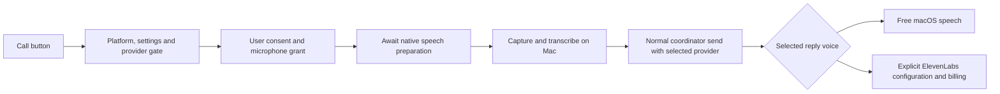

# Coordinator calling readiness

October 23, 2026. Increment 1022. Source baseline `ef227c979`. Owned checkout `/Users/you/.specwithcode/m4/worktrees/coordinator-readiness-1022`.

## Verdict

The most likely reference is the phone button: its shipped tooltip is **Call the coordinator and talk**. This is a macOS voice conversation, not a requirement for an AI API key. Ordinary users can use native speech with a signed-in coding-provider subscription. ElevenLabs is optional, requires the user's own key and voice ID, and bills that account. No maintainer voice ID, credential or user path was found in the audited production voice/default-selection paths.

Do not claim full production acceptance yet. This patch validates source behavior and isolated UI/native contracts. The installed microphone, local speech assets/language and complete spoken coordinator response still need human acceptance. No credentials or real account settings were read or changed, and no paid/provider turn was sent as a test.

## Shipped surfaces and prerequisites

| Surface | Production path | Prerequisites and boundary |
| --- | --- | --- |
| Phone button | `/Users/you/.specwithcode/m4/worktrees/coordinator-readiness-1022/apps/web/src/components/studio/VoiceCall.tsx`, `/Users/you/.specwithcode/m4/worktrees/coordinator-readiness-1022/apps/web/src/components/studio/ProjectWorkspaceSurface.tsx` | Desktop bridge, macOS, loaded voice settings, an available tool-capable coordinator provider, app consent, microphone grant, on-device speech helper/assets and supported system language. The browser web app has no desktop bridge and hides this desktop-only action. Windows/Linux bridge reports unsupported; this patch disables the action with its reason. |
| Native capture/transcription/speech | `/Users/you/.specwithcode/m4/worktrees/coordinator-readiness-1022/apps/desktop/src/ipc/methods/voice.ts`, `/Users/you/.specwithcode/m4/worktrees/coordinator-readiness-1022/native/voice/main.swift` | Packaged `resources/voice/studio-voice`, not a developer's Swift compiler. Dev builds can compile the helper. macOS 26 uses SpeechAnalyzer and may download Apple speech assets; earlier supported macOS uses authorized on-device SFSpeechRecognizer. No cloud transcription fallback. |
| Optional cloud reply voice | `/Users/you/.specwithcode/m4/worktrees/coordinator-readiness-1022/apps/server/src/voice/VoiceSpeech.ts`, `/Users/you/.specwithcode/m4/worktrees/coordinator-readiness-1022/apps/server/src/voice/elevenLabsVoice.ts` | Explicit ElevenLabs selection, key in server secret store, valid voice ID, authenticated server RPC with `orchestration:operate`. Missing/invalid key, denied voice, quota, invalid response and network failures return actionable errors. No silent switch of voice. This patch also includes the RPC in client permission checks. |
| Coordinator message/start | `/Users/you/.specwithcode/m4/worktrees/coordinator-readiness-1022/apps/server/src/project/ProjectWorkspaceRpc.ts`, `/Users/you/.specwithcode/m4/worktrees/coordinator-readiness-1022/apps/server/src/project/ProjectCoordinatorService.ts` | Project admission, valid local source thread, selected provider, compatible directory permissions; calls preserve durable send IDs and queue native intake. This patch rejects unavailable/no-tools providers before binding or sending. |
| Worker follow-up | `/Users/you/.specwithcode/m4/worktrees/coordinator-readiness-1022/apps/web/src/studio/projectMessageRouting.tsx` | Local worker composers use direct native sends; routed composers explicitly use coordinator routing. Native approvals/questions stay native. Draft/files clear only on acknowledgment. |
| Aide project routing | `/Users/you/.specwithcode/m4/worktrees/coordinator-readiness-1022/apps/server/src/mcp/toolkits/project/route.ts` | Only the personal assistant's own coordinator; target must be within approved real folders, not archived/paused/private-ineligible; target runtime/interaction modes cannot exceed caller limits. User-authored message provenance and idempotency key are checked. No new folder/account grant. |
| Worker/provider choice and quota handoff | `/Users/you/.specwithcode/m4/worktrees/coordinator-readiness-1022/packages/shared/src/coordinatorDefault.ts`, `/Users/you/.specwithcode/m4/worktrees/coordinator-readiness-1022/packages/shared/src/providerFallback.ts` | Host/project defaults are distinct from explicit choice. Existing fallback/limit policy remains 1003/0968 scope. No automatic Gemini/Vertex, API-key or paid-router choice in the patched host default. Native Claude/Codex/Copilot paths remain available. |

The word **key** could mean a keyboard send shortcut, routing/idempotency identifier, provider credential or optional ElevenLabs credential. Source only establishes that ElevenLabs needs a key; no key is needed for macOS speech. Coordinator calls are not a separate publicly exposed LLM API. The voice controller sends transcribed text through the same project coordinator route and waits for a new reply in that conversation.

## Gaps fixed

1. Voice availability previously meant only that the Electron methods existed. On Windows/Linux the action appeared usable until attempted. The hook now checks native platform status and displays the reason on the disabled action.
2. Native speech preparation previously ran after activating a call, with every failure discarded. The microphone could begin recording while Apple assets were downloading or the helper/language was unsupported. Preparation is now awaited before capture, with exact helper errors surfaced. Older macOS preparation now validates speech authorization and on-device language support too.
3. An incomplete ElevenLabs selection previously failed only after recording, transcription and an AI response. The action is now gated before recording and points to Voice settings or free macOS speech. Loaded server settings are required, so startup defaults cannot mask a configured paid voice. Consent explicitly names ElevenLabs credits and the selected AI provider's separate billing.
4. Automatic host selection only excluded Claude API instances. It now excludes every known per-token provider, Gemini/Vertex, paid API/router models and models explicitly lacking tool calls. Mixed Pi/OpenCode catalogs require proven local/subscription billing; unknown supplier billing requires explicit user choice. Known local models remain usable without cloud authentication.
5. Saved coordinator choices could reach launch/send without provider availability checks. They now fail with Settings > Providers guidance, or tool-support guidance, before reserving or dispatching work. Explicit paid choices stay explicit and are not overwritten. Existing directory/grant and native subscription paths are preserved.

## Evidence and limits

All logs/screenshots/receipts are under `/Users/you/.specwithcode/m4/evidence/coordinator-readiness-1022` once the final receipt copy is complete.

- Final combined run: 174/174 tests in 12 files passed. Within it, 75 focused selection/coordinator/voice/helper/contract tests passed. Catalogs and audio are synthetic; there are no account credentials.
- 49 existing route integration, workspace lifecycle and server speech tests passed. The real route tools and coordinator service execute against an isolated in-memory project environment with real scratch folder/attachment boundaries.
- 50 existing voice controller/reply/auth tests passed. Cancellation, native input and authorization are exercised without live audio.
- Headless browser fixture: five scenarios passed, no page errors. Fresh native call requires consent before synthetic capture; hang-up closes capture; unsupported desktop, missing provider, missing cloud setup and missing helper are gated/actionable. Real call controls and hook, synthetic environment/audio. The product preview worked for initial inspection, then explicitly reported its automation host unavailable; the remaining check used Playwright with `headless: true`, `PWDEBUG=0`, `PLAYWRIGHT_HTML_OPEN=never`.
- Read-only installed native helper status returned `engine: analyzer`, `speech: notDetermined`, `ok: true`. Compiled patched helper returns the same. Neither requests speech authorization, records audio or proves speech assets ready. This is evidence that the packaged helper exists, not call acceptance.
- Current app MCP catalog advertised Codex, Claude and Copilot routes as runnable, with disabled/uninstalled OpenCode/Pi clearly constrained. These are metadata, not live entitlement/capacity proof. No provider turn was sent.
- Patched native helper generated a valid 1.614240-second, 146472-byte WAV without playback or credentials. This proves native speech output on this Mac, not a complete voice conversation.
- Fresh-context review of `84f488335`: zero findings; independent Node 22.20 focused rerun passed 103/103 tests. Review at `/Users/you/.specwithcode/m4/evidence/coordinator-readiness-1022/fresh-review.md`.
- Production web, server and desktop bundles built; native Swift helper compiled. Retained compiler warnings and unrelated server typecheck failures are recorded in the evidence, not hidden. Web and shared typechecks passed with suggestions. The initial server typecheck did not establish absence of regressions: PR #633 CI subsequently identified two new TS377033 warnings in the changed coordinator tests. The initial outside-changed-code characterization was incorrect for these two warnings. See the correction below; full logs are retained.

## Acceptance still required

On a normal signed-in macOS installation, a human must grant microphone/speech access, wait for first-use Apple assets, speak a request, hear a correct coordinator reply, mute and hang up, and verify capture stops. Repeat with no ElevenLabs configuration using native speech. An explicitly configured ElevenLabs account needs a separately authorized paid spoken-reply check; no charge is authorized by this audit.

The repository's `/Users/you/.specwithcode/m4/worktrees/coordinator-readiness-1022/AGENTS.md` says: "New UI/auth needs concrete manual acceptance before increment closure." Therefore keep 1022's final task open until that acceptance is recorded. Source tests and browser fixtures do not replace it. Release 1015 owns publication; this lane does not dispatch or restart the app.

## PR 633 typecheck correction

The required CI gate on `dd7851aa9f9305a6a1c08bef2dd529b23c1c4a92` found two new TS377033 diagnostics at lines 988 and 1004 of `/Users/you/.specwithcode/m4/worktrees/coordinator-readiness-1022/apps/server/src/project/ProjectCoordinatorService.test.ts`. Both new tests chained `Effect.provide(Coordinator.layer)` and `Effect.provide(f.dependencies)`. They now provide one composed layer: `Effect.provide(Coordinator.layer.pipe(Layer.provideMerge(f.dependencies)))`. Fixture dependencies feed coordinator construction and remain available to the test effect within the same provision graph and scope.

No baseline, diagnostic suppression, production code, assertions or acceptance requirements changed. The independent narrow review passed with zero findings: `/Users/you/.specwithcode/m4/evidence/coordinator-readiness-1022/pr633-typecheck-fresh-review.md`. The focused repair rerun passed 174/174 tests across 12 files: `/Users/you/.specwithcode/m4/evidence/coordinator-readiness-1022/pr633-repair-tests.log`.

Matching validation uses `CI=1 TYPECHECK_TSC_ARGS='--checkers 2' bash scripts/studio-verify/typecheck-gate.sh` across all 15 workspace packages. Result: **15 packages, zero new diagnostics, passed**. The server retains only diagnostics accepted by the unchanged existing baseline. Final gate log: `/Users/you/.specwithcode/m4/evidence/coordinator-readiness-1022/pr633-typecheck-final.log`. Per-package logs: `/Users/you/.specwithcode/m4/evidence/coordinator-readiness-1022/pr633-typecheck-final`. The first local run was incomplete because the owned checkout lacked locked dependencies and an Astro executable link; isolated dependency setup was repaired without changing shared installs or the baseline.

Installed T-04 remains open. Parent release owner retains watching, merging and release dispatch.
