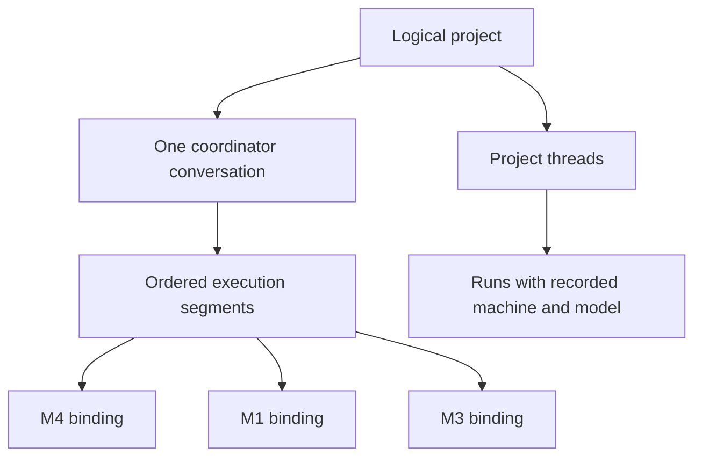

# One project across machines

A project is the identity of the work: its name, intent, coordinator conversation, and threads. A machine registration is a location where that project can execute. A Git folder, provider session, or handoff worktree is not another project.



The sidebar and project link use the logical identity. The coordinator runs on one admitted binding, and a linked machine can run its own coordinator beside it ([An orchestrator on each machine](#an-orchestrator-on-each-machine)). A worker keeps its own machine and provider. Thread references contain both the environment and thread ID, so identical local IDs on two hosts cannot open the wrong conversation.

The logical project's name appears in its sidebar, coordinator header, desktop window, settings, and handoff review. A checkout named for an old handoff does not replace that name. Renaming through settings targets the current active coordinator's project, even when those settings are scoped to an earlier machine. A disconnected, denied, conflicting, or transferring owner must be resolved before renaming. Checkout-specific settings and deletion keep their original scope.

Legacy repository grouping can display a selected handoff checkout's title while the original project and its threads still exist. That is not evidence that either project was deleted or that their histories belong together. Such records require explicit association; the app does not recover a name or merge history by guessing from repository URLs or handoff labels.

## Switching the coordinator

Choosing another machine starts a checked handoff. The review names the destination and the committed Git checkpoint. The source persists its transfer state before publication or destination execution. The bundle is pinned to the chosen environment and project; another matching repository cannot receive it accidentally.

The destination retains the context, creates a safe execution checkout, and returns the accepted coordinator receipt. That checkout belongs to the same logical project. The source then records the completed transfer and remains unable to run the old coordinator. Ordinary workers can continue on their own machines after acknowledgment.

A lost response does not authorize a second coordinator. Retry the same handoff operation. While its outcome is unresolved, the UI shows the pending transfer and the source does not silently resume. Project settings cannot clear an ownership fence.

Recovery stays available across the logical project's bindings after the active coordinator moves or the page reloads. If the destination already started, retry confirms its receipt and acknowledges the source without launching it again.

Joining a previously independent destination is an explicit association. Existing history is retained. Repository URLs and project names can suggest a location, but do not establish domain membership or authorize merging an already linked fleet.

## Linking two existing projects

Two independent projects for the same work, one per machine, become one project through an explicit link (`apps/server/src/project/ProjectLink.ts`, RPCs in `packages/contracts/src/projectLinkRpc.ts`). The client drives both machines, as for handoff:

1. `projectLink.preview` on both copies: identity, binding, repository fingerprint, notes, goal, instructions, last coordinator activity and any refusal.
2. `projectLink.prepare` on the kept copy. A project created before shared identities gets one first (`adopt-identity`: `logical:<uuid>`, itself as the only member, binding epoch 0 active). Project IDs never change.
3. `projectLink.accept` on the joining copy (`join-as-member`): it checks that the fingerprints match at the root, then adopts the kept identity with a relinquished binding at the kept epoch, `successor` = the kept member. Its coordinator is fenced; ordinary workers continue.
4. `projectLink.commit` on the kept copy: writes the chosen notes, then lists the joining copy (`link-member`: same identity, binding unchanged).

Each step is idempotent by state, and project command IDs include the project revision, so retrying the same operation never applies a step twice. A missing step 4 leaves the joining copy deferring to the kept coordinator, which keeps sending safe; the UI offers Finish linking. Remote workers then use the copy because `isLogicalProjectBinding` holds in both directions.

`projectLink.unlink` with `side: "member"` gives the member a fresh identity and an active epoch-0 binding (`unlink`, the only non-handoff path from relinquished to active), copying the kept notes it lacks; `side: "coordinator"` removes the member from the kept identity (`remove-member`). Every ownership update names its mode, and `ownershipRejection` in `ProjectCommands.ts` refuses any other transition. Servers without the `projectLink` capability are reported as needing an update.

### Replicas and coordinator takeover

A member keeps a replica of its coordinator's notes, goal and instructions in `coordinator-replicas/<hash of project id>.json` in its state directory (`apps/server/src/project/CoordinatorReplicas.ts`; owner-only, atomic rewrite, database untouched). The servers keep it fresh with no app window open; see [Server-driven sync](#server-driven-sync). The pass compares the coordinator's content digest (sha256 over goal, instructions and sorted notes) with the replica digest on each member and, on a difference, copies the coordinator's content into the member, which recomputes the digest and refuses a mismatch, a replica from its own machine, or another identity. A replica records the coordinator's epoch (`fromEpoch`) and is never replaced by one from a lower epoch, so two copies that both coordinate after a takeover do not keep overwriting each other's replica. For pairs no server covers, `CoordinatorSync` in the root route does the same through `projectLink.digest`, `projectLink.preview` and `projectLink.replicate` every 60 s and on any binding, settings or reachability change.

### Server-driven sync

`apps/server/src/project/LinkedPeerSync.ts` drives the replica, two-way memory, plan claims and supersede from the servers. Each pair of copies of one logical project is driven by exactly one server, the one with the lower environment ID (`drivesPair` in `packages/shared/src/linkedPairSync.ts`); the other only answers. Supersede is the exception: the copy that took over drives it, since only it holds the new binding. The loop runs a pass every 60 s, at once when a linked machine calls this one again after a failure, within 60 s when a machine the last pass could not reach answers a reachability probe (`HandoffPeers.reachable`, which sends no request), within 10 s of a link being made or removed, and within 10 s of a work grant appearing on a machine a pass could not call for want of one (its pairs are then due at once, and member lists held for it are sent again). Passes never overlap; they are skipped while `ServiceUpdateHold` holds the service, and a hold or shutdown that begins mid-pass stops it before its next call. Toward a machine too old for these paths (`outdated`), the pair's driver still moves memory over `memory-export` and `memory-merge`, and so does a coordinator's server toward older copies whose pair it does not drive, as the coordinator's server did before.

A pass calls the peer over the handoff peer route with this machine's work grant there, so it drives only pairs toward machines it holds a grant on. The versioned paths are `linked-digest`, `linked-content`, `linked-replica`, `linked-supersede`, `linked-members`, `plan-export` and `plan-merge` (protocol version `LINKED_SYNC_PROTOCOL_VERSION` in `apps/server/src/handoff/linkedSyncWire.ts`), plus the existing `memory-export` and `memory-merge`. The receiver (`apps/server/src/project/LinkedPeerRoute.ts`) refuses its own machine, a machine the project does not list, a grant whose project list leaves the copy out, another identity, another protocol version and bodies over `LINKED_SYNC_PEER_MAX_BYTES`; it accepts content, memory, plans or a supersede only in the caller's own name, checks membership before anything else about the copy, takes a replica from another member than the copy it gave way to only at one epoch past it (longer takeover chains are left to the app), and gives way only after the successor confirms over the peer route that it holds that takeover binding. When this machine can never ask the successor (no grant there, revoked or expired, the successor is not in its fleet, it refuses this machine's grant, or it predates the digest path), the successor stands for itself: it signed in with the grant this machine issued to it and may claim only its own takeover, so a confirmation would add only freshness, which is checked locally instead. The claim must name this very copy as predecessor, come from a listed copy, carry an `operationId`, be at a higher epoch than this copy's binding and have a `takenOverAt` later than this copy's own; a copy that already gave way never moves to another successor on a claim alone. A successor that does not answer, answers with another binding, or refuses otherwise, is never taken at its word: the supersede is refused `busy` and the successor tries again. It reuses the `ProjectLink`, `LinkedMemorySync` and `ProjectPlanService` operations the app calls, and the decisions are the shared ones in `packages/shared/src/linkedPairSync.ts`, `linkedMemorySync.ts` and `linkedPlanSync.ts`.

Member lists follow the coordinator (`apps/server/src/project/ProjectLinkMembers.ts`). A transferred copy adopts the list of the copy it gave way to (additions and removals), whether that copy coordinates or gave way in turn and relays its own successor's list; from another machine it takes nothing, since a claimed epoch is that machine's own word. Only the app (`projectLink.syncMembers`), which read the coordinator itself, may send additions from a coordinator one takeover later, with the same epoch check as a replica. The list arrives through the optional `members` field of `linked-digest` (the pair's driver pulls from the copy it gave way to, and a copy that gave way reads it from its successor on every pass even when the successor drives the pair), the `linked-members` path (the driver pushes to a copy that gave way to it, and so does a coordinating copy to the copies it only watches, so the list arrives whichever way the environment IDs sort and whichever side holds the grant), `projectLink.syncMembers` from the app on servers with the `linkedMembersSync` capability (`CoordinatorSync`, every 60 s, for pairs no server drives), or a refresh from the copy it gave way to when a re-arm consent names a machine this copy does not list. Adopting never drops the copy itself or the copy it gave way to, never rewrites its own entry, never lists a second copy on its own machine and never changes its binding (ownership mode `sync-members`). A copy that took over adds the members its predecessor lists in the `members` field of the `linked-supersede` answer (mode `link-member`), except members it unlinked since the takeover: the binding's optional `removedMembers` remembers them (written by `remove-member`, at most 256). A sync the peer refused is not tried again for that pair until either list changes or 10 minutes pass; one that failed on this machine (no grant there yet), was refused for want of a grant, or got no answer is tried again on the pair's next pass. Linking or unlinking a member on the coordinator starts a pass at once for that project. Member sync is best effort and outside `projectLink.syncStatus`; a peer that predates it sends no `members` and is sent nothing. Limit: a copy that takes over before it learned a later member, from a predecessor it cannot reach, lists that member only after the app syncs it or it is linked again.

Each pass first exchanges digests (binding, coordinator content, replica, memory and plan) and moves content only for a kind whose digests changed since the last pass that left it in step, and at least every 5 minutes. A kind is taken as in step only from digests read right after its own merges, never for a kind the pass skipped; memory that still differs after its retry counts as a failure. A pair that fails backs off 1, 2, 4 then 5 minutes at most; a call from that peer, or a probe that reaches it again, resets it. The copy that took over retries giving way every 5 s (`SUPERSEDE_RETRY_MS`) for the first 10 minutes the old coordinator does not answer (`QUICK_RETRY_WINDOW_MS`), then once a minute (never the minutes of a pair's backoff, since the old one may hold no grant to call back), so the old one gives way within seconds of being reachable again, whichever of the two holds a grant on the other. Those quick retries wake a pass over only the pairs waiting for one. A copy that only reads its successor's list backs off the same way when the successor does not answer. A peer that answers 404 for an unknown path predates server-driven sync and is reported as `outdated`.

`projectLink.syncStatus` returns, per pair and kind, the last success, last attempt and last error (`needs_grant`, `unreachable`, `outdated`, `refused` or `failed`). The status is in memory only. The app skips a pair in `CoordinatorSync`, `LinkedMemorySync` and `LinkedPlanSync` only when both servers advertise the `serverLinkedSync` capability and the driving server reports a success for that kind within the last 3 minutes (`SERVER_SYNC_FRESH_MS`); otherwise it keeps driving the pair as before, for example after a restart, without a grant, or toward an older server.

`projectLink.takeover` runs on a member when the coordinator's machine has been unreachable for 10 minutes; the client enforces the wait from the machine's last-seen time, since a server cannot judge another machine's reachability. It names the coordinator the client sees as `predecessor`, writes the replica's notes (a differing local note is kept as `<name>-before-takeover.md`), goal and instructions, and moves the binding to active at `max(own epoch, knownEpoch) + 1` with `predecessor` and `takenOverAt` (mode `takeover`). When both machines are reachable, the client calls `projectLink.supersede` on the old owner, which becomes transferred at the new epoch with `successor` and `takenOverAt` (mode `superseded`) and returns the coordinator turns it started since `takenOverAt` for review; `projectLink.preview` keeps returning them. Supersede refuses a lower or equal epoch, an unlisted successor or a copy that is no longer active. The highest epoch wins in `logicalCoordinator` meanwhile. Servers without the `coordinatorTakeover` capability are skipped.

### Automatic takeover (opt-in standby)

Off by default. One member per logical project may be its standby, armed by the owner on both sides from the desktop app (`apps/web/src/studio/standbyArming.ts`, UI in `apps/web/src/components/studio/CoordinatorStandbySettings.tsx`): `projectLink.setStandby` on the active coordinator writes `coordinatorBinding.standby` (`member`, `afterMinutes` of 5 (default), 15, 30 or 60, `enabledAt`) through ownership mode `set-standby`, and `projectLink.acceptStandby` on the standby registers that coordinator and epoch (`apps/server/src/project/ProjectLinkStandby.ts`). Accept refuses an active copy and a server without the `coordinatorStandby` capability. Before either, arming gives the standby a worker grant on each machine W that runs the coordinator's workers: invite on W, add W on the standby, allow at the coordinator's own access on W, narrow the grant to W's copy (`projects: listed`), then revoke the invitation's management session. A live grant is reused and only gains the project when it is `listed`. No credential is minted between the standby and the coordinator.

The coordinator sends `coordinator-lease` to the standby every 30 s over the handoff peer route (`apps/server/src/project/CoordinatorLease.ts`, handler in `apps/server/src/project/CoordinatorLeaseRoute.ts`). The standby accepts a lease only from the registered coordinator's grant, at the registered epoch, with a `seq` above the last one, and records its own receive time. Planned pauses send `pausedUntil` (at most 30 minutes) or `sleeping`; the desktop app reports suspend to its server directly (`apps/server/src/project/CoordinatorSuspendRoute.ts`). `apps/server/src/project/CoordinatorStandbyWatch.ts` fires only after `afterMinutes` of silence since a lease accepted while it was awake, on a monotonic clock that resets on wall-clock jumps, and only while its grants are armed. The takeover runs under the project lock with `operationId = "auto:" + sha256(logicalProjectId).slice(0,32) + ":" + epoch`, records `takenOverBy: "auto"`, and drops `standby`. It then claims the new epoch on every worker machine (each machine the old coordinator ran a worker on, and every other listed copy this machine links to) and adopts the old coordinator's following workers (`apps/server/src/fleet/RemoteWorkerAdoption.ts`). A worker machine (`apps/server/src/fleet/WorkerEpochStore.ts`) then takes steering for that project only at a higher epoch than the claimed one, or at the claimed epoch from the environment that claimed it, so two machines that each reached the same epoch never both steer.

The standby side runs on every server as its own loop (`apps/server/src/project/CoordinatorStandbyLoop.ts`, wired in `apps/server/src/server.ts` beside the lease loop): parked until the server is activated, then every 30 s it ticks the watch for each record in `coordinator-standby.json` and, for each one due, runs `autoTakeover`, the epoch claims and the adoption, in that order. A round does nothing while a service update holds the machine. The lease route answers `busy` then, so the coordinator stays unfenced; on the first round after the hold, silence counts from the hold's end, as after a planned pause, so a coordinator that died during the hold is still taken over `afterMinutes` later. A claim that got no answer is retried on later rounds with backoff (30 s doubling to 30 minutes) until every machine answered; the takeover replays by its operation id, and a repeated claim and adoption change nothing. After a restart each armed project is checked once, so a follow-up the old process owed still runs. A registration is spent once this copy's binding moves past its epoch (it took over, or was superseded or handed on since), or once this copy coordinates itself or was unlinked: `autoTakeover` then removes it and publishes `standby-released`, so it never fires again from the old coordinator.

The coordinator fences itself (`apps/server/src/project/CoordinatorWakeGate.ts`): with a standby set it refuses and interrupts coordinator turns once its last successful lease is older than `afterMinutes` minus 130 s, and lifts the fence after one lease answered without a takeover. Silence is measured on the wall clock and, within the process, on the monotonic clock too, so a wall clock stepped backwards cannot hold the fence down past the standby's own deadline. Right after the process resumes from a pause over 30 s (`RESUME_PAUSE_MS`: the process was stopped or the machine slept, seen as a gap between two looks at the wall and monotonic clocks, or by the gate itself before the next look), the coordinator of a linked copy with other copies refuses new turns (a queue stays queued, as for a fence) until a linked pass begun after the resume reached every other copy or 15 s passed (`RESUME_HOLD_MS`); the resume makes every pair due at once. A copy this machine cannot ask is still waited for up to 15 s, since it may reach this one and say it took over. A queue refused meanwhile is looked at again every 2 s, so it starts once the hold ends. The gate refuses rather than waits, since a turn waiting under its thread's lock would hold up the give-way it waits for. A copy that was taken over meanwhile then refuses the turn as superseded, or fences it at turn start once it gave way. Unlinked projects, copies with no other copy and workers never wait. When the lease records cannot be read, the gate fails closed from the last records the process read; before any read succeeded it lets turns start, so a project without a standby is never blocked. A standby announced as busy or sleeping pauses the fence; "Run here anyway" turns the standby off. Turning the standby off or changing it, a handoff, unlink, archive and supersede release the standby first, or need `changeAnyway`. On a `takenOver` answer the old coordinator verifies the new binding and supersedes itself. Leases and replicas use the handoff peer transport, so they run over Tailscale or over Connect with DPoP-bound worker grants; arming over Connect revokes the management session its invitation was redeemed for. Handoff-mode threads continue only on the machine the source named (`apps/server/src/handoff/HandoffAutoContinue.ts`), never coordinator threads. Limits: one standby, no election, no automatic hand-back, and memory written after the last sync stays behind.

### Auto re-arm

Off unless the owner lists machines under "If it takes over, arm next" (at most 3 after the standby; the schema takes 6). Saving the list writes a re-arm consent, `{chainId, members, afterMinutes, fromEpoch}`, on the standby and on each listed machine through `projectLink.acceptStandby` with `rearm` (`apps/web/src/studio/standbyArming.ts`), after giving every listed machine a worker grant on every other listed machine and on each worker machine. A consent-only call fails on a server without the `coordinatorRearm` capability, and the app marks that machine "needs an update" instead of sending it. Saving the list first syncs each listed machine's member list from the coordinator (`projectLink.syncMembers`), so a machine that joined before another one was linked accepts a list naming it; a machine that still refuses shows its own reason. The consent lives on each machine (`coordinator-rearm.json`, `apps/server/src/project/CoordinatorRearmStore.ts`); the coordinator binding carries no list.

After an automatic takeover, the copy that took over runs its own loop (`apps/server/src/project/CoordinatorStandbyRearm.ts`): it picks the first listed machine that answers a `linked-digest` probe as a transferred copy, registers itself there through `studio_coordinator_claim_epoch` with `standby: {chainId}`, then names it as its standby. The receiver accepts only with its own consent of the same chain, from a listed caller identified by its work grant, at or above `fromEpoch`, with the owner's `afterMinutes`, and never replaces a registration at a higher epoch or from another coordinator at the same epoch. The new standby counts as armed only after a lease reaches it; one that never got a lease is dropped and the next one tried, while a silent one that may have got a lease keeps the usual fence. The owner choosing a standby, turning takeover off or taking over by hand stops the run. A person takeover also sends `standby: null, belowEpoch` to every connected member with the capability, so a standby registered for an older coordinator does not fire, and every standby checks its epoch claims before firing. The coordinator's Machines settings show "No standby armed yet" with the reason, "Checking", or the machine it armed, read from `projectLink.syncStatus` `standbyRearm`. On opening, the app reads each machine's consent and grants and offers "Prepare machines again" when one is missing or runs out; saving the list again writes a new chain. Turning takeover off removes the consent from every list machine that answers.

### Coordinator role for other services

Server code that should act only where this machine coordinates a project (routines failover, for one) uses `CoordinatorRole` (`apps/server/src/project/CoordinatorRole.ts`, provided by the orchestration runtime). `roleOf(projectId)` returns this copy's role from its own `coordinatorBinding`: `active` while the binding is active, with its `epoch`, `state` and `logicalProjectId`; a copy without a binding, linked or not, is active at epoch 0, and a missing or deleted project returns none. Several copies may be active at once (each machine may run its own coordinator); the highest epoch is the newest, as `logicalCoordinator` orders them in the client. `changes` streams role changes on this machine from the moment of subscription: `took-over` (a person's or an automatic takeover, starting this copy's coordinator, or unlinking, which makes it the coordinator of its own project at epoch 0, with `epoch`, `predecessor` and `takenOverBy`), `gave-way` (superseded, including the lease loop giving way to a standby, or joining another copy's project as a member, with `epoch` and `successor`), `standby-armed` and `standby-released` (with the reason: turned off, released, grant scope or revocation, project removed, outdated). They are published by ProjectLink and the lease receiver after the change is written. A copy another machine superseded without reaching this one still reads as active until it hears of it, and a handoff of the whole project is not published; read `roleOf` again after one.

### Routines follow the coordinator

With a standby armed, the lease loop also sends the standby the project's coordinator-owned routines (`ownThread`, not webhook) as `routines` on `coordinator-replica`, at most 200 and 256 KiB of JSON (larger sets send none), with `routinesDigest` on every lease (`apps/server/src/scheduledTasks/ScheduledTaskCopies.ts`). Both fields are optional and kept apart from `contentDigest`, so a standby that predates them still accepts the notes; the lease protocol version is unchanged. The standby asks for content again when the digest it holds differs, and keeps the routines under the same ids in its own copy, marked `copiedFrom: <logicalProjectId>` in `run_policy_json`; the coordinator marks the routines it sends the same way. Marked routines no longer sent are deleted unless the list was full, so a routine deleted on a new coordinator also leaves the old one once it stands by. Unchanged copies are not saved again. An id another project uses on the standby is skipped. Webhook URLs and signing secrets never travel.

`ScheduledTaskCoordinatorGate.ts` reads `CoordinatorRole.roleOf` before every fire of a coordinator-owned routine: `transferring` waits (stays due), a copy that is not active rests (moves to its next time with a note, cleared on `took-over`), an active copy fenced by `CoordinatorWakeGate` waits. Unlinked projects, webhook and worker-bound routines are not gated. A daily or monthly run missed by more than 10 minutes records a skip note in `lastRunError` (`missedRunNote` in `Schedule.ts`). Limits: the linked sync path does not carry routines, so a person's takeover on a copy that was never the standby starts without them.

### Two-way memory

Members that each run a coordinator write project memory independently, so memory also replicates in both directions. Each server keeps the last 50 sha256 hashes every memory file has had on that machine, and a tombstone with that history when a file is deleted, in `linked-memory/<hash of project id>.json` in its state directory (`apps/server/src/project/LinkedMemoryHistory.ts`; owner-only, atomic rewrite, database untouched). Every memory write and delete records its version there; a lost or damaged history file never loses content, because files it can no longer order are merged as concurrent edits, which keep both versions.

The servers sync memory for the pairs they drive ([Server-driven sync](#server-driven-sync)) with the same calls the app makes. `LinkedMemorySync` in the root route covers the remaining pairs: it runs every 60 s and when a copy comes online or is linked. For each pair of reachable copies with the `linkedMemorySync` capability (any binding state) it calls `projectLink.memoryExport` on both, then `projectLink.memoryMerge` on each side with the other's export, so a side that fails never changes what the other sees and the next pass converges. A merge refuses another identity, an unlisted peer, this machine, a payload over `PROJECT_LINK_MAX_BYTES`, or content that does not match its hash. `apps/server/src/project/linkedMemoryMerge.ts` decides each file the peer sent; files only this machine has are never touched:

| Case                                                | Result                                                                                                                                                                                                                                  |
| --------------------------------------------------- | --------------------------------------------------------------------------------------------------------------------------------------------------------------------------------------------------------------------------------------- |
| Same content on both                                | Histories are joined                                                                                                                                                                                                                    |
| The peer's content is in this file's history        | Kept: this side is newer                                                                                                                                                                                                                |
| This content is in the peer's history               | The peer's version is written                                                                                                                                                                                                           |
| Neither history knows the other's content           | The later write wins (tie: larger environment ID). The winning machine keeps its file; the other saves its own version as `<base>.conflict-<machine>.md` before taking the winner, adding `-2`, `-3` when that name holds other content |
| A file here, the peer's tombstone lists its content | Deleted                                                                                                                                                                                                                                 |
| A tombstone here lists the peer's content           | Stays deleted                                                                                                                                                                                                                           |
| Any other file against a tombstone                  | The file is kept or restored                                                                                                                                                                                                            |

`MEMORY.md` is never deleted by replication: a peer's tombstone for it is ignored and a local one never blocks the peer's copy. Identical content never produces a conflict copy. The one-way replica and takeover flow above still runs for older peers.

## An orchestrator on each machine

A linked project can run an active coordinator on every member machine, so the project keeps going while one machine is off. `projectLink.startCoordinator` (capability `coordinatorPerMachine`) gives the calling member its own active binding; it does not move or fence the other coordinator. Each coordinator owns the threads it started or that were migrated to it. Another coordinator reads those threads but cannot send to, steer or stop them (`apps/server/src/mcp/workGrantAccess.ts`). Pairing grants work both ways for the linked project only, and `apps/server/src/fleet/workGrantPolicy.ts` still refuses delegation loops.

### Viewing, moving and migrating

The machine switcher under the project composer (`apps/web/src/components/studio/OrchestratorSwitcher.tsx`) has three separate actions:

| Action                         | What it does                                                                                                                                                             | What moves                                                            |
| ------------------------------ | ------------------------------------------------------------------------------------------------------------------------------------------------------------------------ | --------------------------------------------------------------------- |
| View _machine_'s orchestrator  | Reads that machine's coordinator conversation, threads, plan and memory from its own server. A message typed there is sent to and handled by that machine's coordinator. | Nothing. The device only remembers which orchestrator it last viewed. |
| Move coordinator to _machine_… | Opens the checked handoff in [Switching the coordinator](#switching-the-coordinator) for review before anything moves.                                                   | The coordinator, recorded as a transfer.                              |
| Migrate threads…               | Moves selected threads through thread handoff, with a preflight result per thread. Disabled until thread handoff ships.                                                  | Only the threads chosen.                                              |

### Online and offline

Online, the view reads the remote server live, so messages and thread state are the same data that machine shows. Offline, the view shows what this device last loaded from that machine, labeled `<machine> unreachable · last synced <time> · read-only`, and the composer refuses to send with the machine's name. Nothing is queued or sent to another machine. A linked machine this device never loaded reads `Unknown`, never an empty list or another checkout in its place.

| Data                                                                                 | How the other machine gets it                                         | Offline                                                                 |
| ------------------------------------------------------------------------------------ | --------------------------------------------------------------------- | ----------------------------------------------------------------------- |
| Project memory files, including `MEMORY.md`                                          | Replicated both ways ([Two-way memory](#two-way-memory))              | Last replicated copy                                                    |
| Plan tasks and claims                                                                | Replicated both ways; each claim names its machine                    | Last replicated copy; claims held on the unreachable machine show Stale |
| Coordinator conversation and thread summaries                                        | Read live from that machine; the viewing device caches what it loaded | The cached copy, read-only, with its sync time                          |
| Thread checkpoints, transcript deltas, handoff notes                                 | Replicated by thread handoff, for threads with handoff on             | Whatever handoff last replicated                                        |
| Full transcripts, tool activity, diffs, terminals, queues, approvals, provider state | Remote read only                                                      | `Unknown`                                                               |

### Plan claims across machines

The servers merge plan claims for the pairs they drive ([Server-driven sync](#server-driven-sync)); `LinkedPlanSync` in the root route covers the rest. It runs every 60 s for reachable copies with the `linkedPlans` capability: `projectLink.planExport` on both, then `projectLink.planMerge` on each with the other's copy. `apps/server/src/project/plan/PlanMerge.ts` merges so that the result is the same whichever copy merges first; the earliest claim wins, ties going to the user, then the smaller machine ID. A claim held by a thread on another machine binds here too, so a local thread cannot take that task. While the holder's machine is unreachable, the claim shows `Stale · <machine> unreachable · only you can release it`; no machine releases it on its own.

### Where a thread runs

`studio_thread_launch` places a thread by this policy (`apps/server/src/mcp/toolkits/project/remoteLaunch.ts`):

1. The machine named in the call. If it cannot take the thread, the launch is refused with the reason; another machine is never substituted.
2. Otherwise, for the coordinator, the project's worker machine, if it is reachable, granted, has the project and is signed in to the provider.
3. Otherwise the coordinator's own machine.

The result reports the chosen machine as `placement` with each skipped candidate and its reason. A worker machine is skipped only on a failure that proves it started nothing; a launch whose outcome is unknown is never retried elsewhere.

### Independent checkouts

Two checkouts of one repository that are not explicitly linked stay two projects with two orchestrators and their own branches. Nothing links them by name or by a matching remote. They consolidate through pull requests to the shared remote: the PRs tab on a linked project lists "Pull requests from both machines" with the machine each one came from. Linking ([Linking two existing projects](#linking-two-existing-projects)) does not move threads; each coordinator keeps its own until they are migrated.

## Shared visibility and history

The project shows threads from its explicit machine bindings, including archived threads. Earlier coordinator segments remain readable. Requests use the model recorded on their run and the execution environment of that segment, so changing the current picker does not relabel history.

The coordinator's default `studio_thread_list` reads the authorized logical-project inventory across reachable bindings. Results include environment-qualified thread links, pagination, and per-binding status. A machine that is disconnected, denied, or too old to provide the requested inventory is reported as unavailable or partial. It is never presented as an empty successful project.

This is private federation, not an always-on central transcript server. Unreachable hosts can have newer history that is not available to the current coordinator. The app does not elect another coordinator merely because the current host disconnects; a member runs its own coordinator only when the user starts one there.

## Continuity limits

Handoffs retain bounded conversation text and project context with a committed Git checkpoint. They start a fresh native provider session. They do not move live processes, provider credentials, uncommitted files, or the provider's hidden session state. A transfer that exceeds supported bounds or lacks a safe checkpoint must fail explicitly.

History labels identify the recorded execution host and requested run model. They do not claim to identify the physical keyboard/browser that submitted the request or undocumented provider-side model routing.

Older projects remain readable. Their unrelated histories are not merged automatically by title or repository. Product implementation does not itself migrate live stores, publish a release, or prove acceptance on a physical three-machine fleet.

## Verification

Focused contract, admission, handoff, grouping, scoped-thread, federation, and request-provenance tests cover the domain behavior. `scripts/studio-logical-projects/verify.mjs` starts three isolated servers with synthetic project history and disabled providers, then verifies the built UI using headless Chrome. It writes screenshots and a receipt, and stops only its own process IDs. This verifies real application transport/rendering with fixtures; it is not a live-provider or physical-machine acceptance claim.

With the project's Node 22 dependencies and coverage provider available:

```sh
node scripts/studio-logical-projects/check.mjs /tmp/logical-project-coverage
# Build apps/web, then apps/server before this UI check.
PWDEBUG=0 PLAYWRIGHT_HTML_OPEN=never node scripts/studio-logical-projects/verify.mjs /tmp/logical-project-browser
```

`scripts/studio-logical-projects/two-orchestrators.mjs` starts two isolated servers (M4 and a Minis fixture) with one linked project, an active coordinator on each and providers off, then checks in headless Chrome: a replicated plan claim, a memory conflict copy, the three switcher actions, a message typed in Minis's view running on Minis, pull requests from both machines, Minis going offline while viewed (last synced, read-only, sends refused by name), a stale claim after the partition, `Unknown` for a machine never synced, and reconnecting to a live view. Workers use `link-launch-agent.mjs --echo`; a prompt line `MCP-CALL {"name","arguments"}` makes that one MCP call with the thread's own credential, so the script can claim a plan task as a thread. Build apps/web and apps/server first.

```sh
STUDIO_TEST_CHROMIUM=<chrome-headless-shell> PWDEBUG=0 PLAYWRIGHT_HTML_OPEN=never node scripts/studio-logical-projects/two-orchestrators.mjs /tmp/two-orchestrators
```

The browser check resolves Playwright from the project or the bundled Codex runtime. `STUDIO_TEST_PLAYWRIGHT_MODULE` may name an installed Playwright module path, and `STUDIO_TEST_CHROMIUM` may select an installed Chrome executable. It always launches a separate headless context, keeps ephemeral credentials out of artifacts, verifies that no provider turns occurred, and removes its temporary server stores after stopping them.
