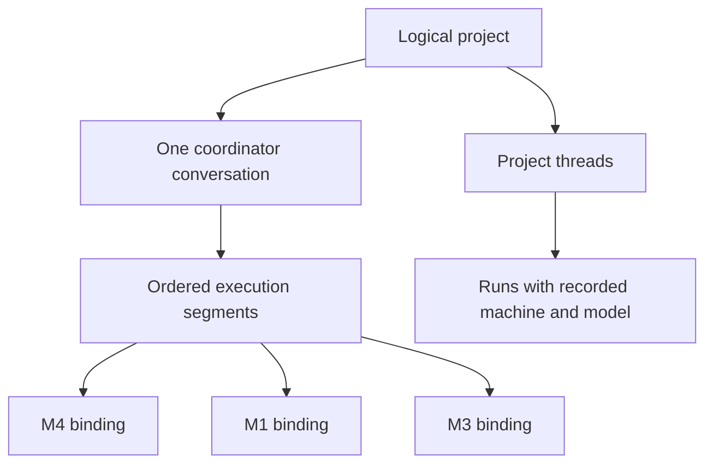

# One project across machines

A project is the identity of the work: its name, intent, coordinator conversation, and threads. A machine registration is a location where that project can execute. A Git folder, provider session, or handoff worktree is not another project.



The sidebar and project link use the logical identity. The coordinator runs on one admitted binding. A worker keeps its own machine and provider. Thread references contain both the environment and thread ID, so identical local IDs on two hosts cannot open the wrong conversation.

The logical project's name appears in its sidebar, coordinator header, desktop window, settings, and handoff review. A checkout named for an old handoff does not replace that name. Renaming through settings targets the current active coordinator's project, even when those settings are scoped to an earlier machine. A disconnected, denied, conflicting, or transferring owner must be resolved before renaming. Checkout-specific settings and deletion keep their original scope.

Legacy repository grouping can display a selected handoff checkout's title while the original project and its threads still exist. That is not evidence that either project was deleted or that their histories belong together. Such records require explicit association; the app does not recover a name or merge history by guessing from repository URLs or handoff labels.

## Switching the coordinator

Choosing another machine starts a checked handoff. The review names the destination and the committed Git checkpoint. The source persists its transfer state before publication or destination execution. The bundle is pinned to the chosen environment and project; another matching repository cannot receive it accidentally.

The destination retains the context, creates a safe execution checkout, and returns the accepted coordinator receipt. That checkout belongs to the same logical project. The source then records the completed transfer and remains unable to run the old coordinator. Ordinary workers can continue on their own machines after acknowledgment.

A lost response does not authorize a second coordinator. Retry the same handoff operation. While its outcome is unresolved, the UI shows the pending transfer and the source does not silently resume. Project settings cannot clear an ownership fence.

Recovery stays available across the logical project's bindings after the active coordinator moves or the page reloads. If the destination already started, retry confirms its receipt and acknowledges the source without launching it again.

Joining a previously independent destination is an explicit association. Existing history is retained. Repository URLs and project names can suggest a location, but do not establish domain membership or authorize merging an already linked fleet.

## Shared visibility and history

The project shows threads from its explicit machine bindings, including archived threads. Earlier coordinator segments remain readable. Requests use the model recorded on their run and the execution environment of that segment, so changing the current picker does not relabel history.

The coordinator's default `studio_thread_list` reads the authorized logical-project inventory across reachable bindings. Results include environment-qualified thread links, pagination, and per-binding status. A machine that is disconnected, denied, or too old to provide the requested inventory is reported as unavailable or partial. It is never presented as an empty successful project.

This is private federation, not an always-on central transcript server. Unreachable hosts can have newer history that is not available to the current coordinator. The app does not elect another coordinator merely because the current host disconnects.

## Continuity limits

Handoffs retain bounded conversation text and project context with a committed Git checkpoint. They start a fresh native provider session. They do not move live processes, provider credentials, uncommitted files, or the provider's hidden session state. A transfer that exceeds supported bounds or lacks a safe checkpoint must fail explicitly.

History labels identify the recorded execution host and requested run model. They do not claim to identify the physical keyboard/browser that submitted the request or undocumented provider-side model routing.

Older projects remain readable. Their unrelated histories are not merged automatically by title or repository. Product implementation does not itself migrate live stores, publish a release, or prove acceptance on a physical three-machine fleet.

## Verification

Focused contract, admission, handoff, grouping, scoped-thread, federation, and request-provenance tests cover the domain behavior. `scripts/studio-logical-projects/verify.mjs` starts three isolated servers with synthetic project history and disabled providers, then verifies the built UI using headless Chrome. It writes screenshots and a receipt, and stops only its own process IDs. This verifies real application transport/rendering with fixtures; it is not a live-provider or physical-machine acceptance claim.

With the project's Node 22 dependencies and coverage provider available:

```sh
node scripts/studio-logical-projects/check.mjs /tmp/logical-project-coverage
# Build apps/web, then apps/server before this UI check.
PWDEBUG=0 PLAYWRIGHT_HTML_OPEN=never node scripts/studio-logical-projects/verify.mjs /tmp/logical-project-browser
```

The browser check resolves Playwright from the project or the bundled Codex runtime. `STUDIO_TEST_PLAYWRIGHT_MODULE` may name an installed Playwright module path, and `STUDIO_TEST_CHROMIUM` may select an installed Chrome executable. It always launches a separate headless context, keeps ephemeral credentials out of artifacts, verifies that no provider turns occurred, and removes its temporary server stores after stopping them.
