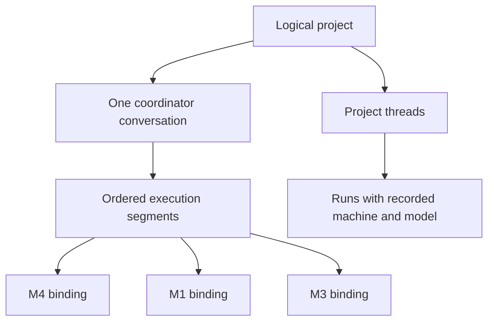

# One project across machines

A project is the identity of the work: its name, intent, coordinator conversation, and threads. A machine registration is a location where that project can execute. A Git folder, provider session, or handoff worktree is not another project.



The sidebar and project link use the logical identity. The coordinator runs on one admitted binding, and a linked machine can run its own coordinator beside it ([An orchestrator on each machine](#an-orchestrator-on-each-machine)). A worker keeps its own machine and provider. Thread references contain both the environment and thread ID, so identical local IDs on two hosts cannot open the wrong conversation.

The logical project's name appears in its sidebar, coordinator header, desktop window, settings, and handoff review. A checkout named for an old handoff does not replace that name. Renaming through settings targets the current active coordinator's project, even when those settings are scoped to an earlier machine. A disconnected, denied, conflicting, or transferring owner must be resolved before renaming. Checkout-specific settings and deletion keep their original scope.

Legacy repository grouping can display a selected handoff checkout's title while the original project and its threads still exist. That is not evidence that either project was deleted or that their histories belong together. Such records require explicit association; the app does not recover a name or merge history by guessing from repository URLs or handoff labels.

## Switching the coordinator

Choosing another machine starts a checked handoff. The review names the destination and the committed Git checkpoint. The source persists its transfer state before publication or destination execution. The bundle is pinned to the chosen environment and project; another matching repository cannot receive it accidentally.

The destination retains the context, creates a safe execution checkout, and returns the accepted coordinator receipt. That checkout belongs to the same logical project. The source then records the completed transfer and remains unable to run the old coordinator. Ordinary workers can continue on their own machines after acknowledgment.

A lost response does not authorize a second coordinator. Retry the same handoff operation. While its outcome is unresolved, the UI shows the pending transfer and the source does not silently resume. Project settings cannot clear an ownership fence.

Recovery stays available across the logical project's bindings after the active coordinator moves or the page reloads. If the destination already started, retry confirms its receipt and acknowledges the source without launching it again.

Joining a previously independent destination is an explicit association. Existing history is retained. Repository URLs and project names can suggest a location, but do not establish domain membership or authorize merging an already linked fleet.

## Linking two existing projects

Two independent projects for the same work, one per machine, become one project through an explicit link (`apps/server/src/project/ProjectLink.ts`, RPCs in `packages/contracts/src/projectLinkRpc.ts`). The client drives both machines, as for handoff:

1. `projectLink.preview` on both copies: identity, binding, repository fingerprint, notes, goal, instructions, last coordinator activity and any refusal.
2. `projectLink.prepare` on the kept copy. A project created before shared identities gets one first (`adopt-identity`: `logical:<uuid>`, itself as the only member, binding epoch 0 active). Project IDs never change.
3. `projectLink.accept` on the joining copy (`join-as-member`): it checks that the fingerprints match at the root, then adopts the kept identity with a relinquished binding at the kept epoch, `successor` = the kept member. Its coordinator is fenced; ordinary workers continue.
4. `projectLink.commit` on the kept copy: writes the chosen notes, then lists the joining copy (`link-member`: same identity, binding unchanged).

Each step is idempotent by state, and project command IDs include the project revision, so retrying the same operation never applies a step twice. A missing step 4 leaves the joining copy deferring to the kept coordinator, which keeps sending safe; the UI offers Finish linking. Remote workers then use the copy because `isLogicalProjectBinding` holds in both directions.

`projectLink.unlink` with `side: "member"` gives the member a fresh identity and an active epoch-0 binding (`unlink`, the only non-handoff path from relinquished to active), copying the kept notes it lacks; `side: "coordinator"` removes the member from the kept identity (`remove-member`). Every ownership update names its mode, and `ownershipRejection` in `ProjectCommands.ts` refuses any other transition. Servers without the `projectLink` capability are reported as needing an update.

### Replicas and coordinator takeover

A member keeps a replica of its coordinator's notes, goal and instructions in `coordinator-replicas/<hash of project id>.json` in its state directory (`apps/server/src/project/CoordinatorReplicas.ts`; owner-only, atomic rewrite, database untouched). The client keeps it fresh from `CoordinatorSync` in the root route: every 60 s and on any binding, settings or reachability change, it compares `projectLink.digest` (sha256 over goal, instructions and sorted notes) on the coordinator with the replica digest on each member, and on a difference sends the coordinator's `projectLink.preview` content through `projectLink.replicate`. The member recomputes the digest and refuses a mismatch, a replica from its own machine, or another identity.

`projectLink.takeover` runs on a member when the coordinator's machine has been unreachable for 10 minutes; the client enforces the wait from the machine's last-seen time, since a server cannot judge another machine's reachability. It names the coordinator the client sees as `predecessor`, writes the replica's notes (a differing local note is kept as `<name>-before-takeover.md`), goal and instructions, and moves the binding to active at `max(own epoch, knownEpoch) + 1` with `predecessor` and `takenOverAt` (mode `takeover`). When both machines are reachable, the client calls `projectLink.supersede` on the old owner, which becomes transferred at the new epoch with `successor` and `takenOverAt` (mode `superseded`) and returns the coordinator turns it started since `takenOverAt` for review; `projectLink.preview` keeps returning them. Supersede refuses a lower or equal epoch, an unlisted successor or a copy that is no longer active. The highest epoch wins in `logicalCoordinator` meanwhile. Servers without the `coordinatorTakeover` capability are skipped.

### Two-way memory

Members that each run a coordinator write project memory independently, so memory also replicates in both directions. Each server keeps the last 50 sha256 hashes every memory file has had on that machine, and a tombstone with that history when a file is deleted, in `linked-memory/<hash of project id>.json` in its state directory (`apps/server/src/project/LinkedMemoryHistory.ts`; owner-only, atomic rewrite, database untouched). Every memory write and delete records its version there; a lost or damaged history file never loses content, because files it can no longer order are merged as concurrent edits, which keep both versions.

`LinkedMemorySync` in the root route runs every 60 s and when a copy comes online or is linked. For each pair of reachable copies with the `linkedMemorySync` capability (any binding state) it calls `projectLink.memoryExport` on both, then `projectLink.memoryMerge` on each side with the other's export, so a side that fails never changes what the other sees and the next pass converges. A merge refuses another identity, an unlisted peer, this machine, a payload over `PROJECT_LINK_MAX_BYTES`, or content that does not match its hash. `apps/server/src/project/linkedMemoryMerge.ts` decides each file the peer sent; files only this machine has are never touched:

| Case                                                | Result                                                                                                                                                                                                                                  |
| --------------------------------------------------- | --------------------------------------------------------------------------------------------------------------------------------------------------------------------------------------------------------------------------------------- |
| Same content on both                                | Histories are joined                                                                                                                                                                                                                    |
| The peer's content is in this file's history        | Kept: this side is newer                                                                                                                                                                                                                |
| This content is in the peer's history               | The peer's version is written                                                                                                                                                                                                           |
| Neither history knows the other's content           | The later write wins (tie: larger environment ID). The winning machine keeps its file; the other saves its own version as `<base>.conflict-<machine>.md` before taking the winner, adding `-2`, `-3` when that name holds other content |
| A file here, the peer's tombstone lists its content | Deleted                                                                                                                                                                                                                                 |
| A tombstone here lists the peer's content           | Stays deleted                                                                                                                                                                                                                           |
| Any other file against a tombstone                  | The file is kept or restored                                                                                                                                                                                                            |

`MEMORY.md` is never deleted by replication: a peer's tombstone for it is ignored and a local one never blocks the peer's copy. Identical content never produces a conflict copy. The one-way replica and takeover flow above still runs for older peers.

## An orchestrator on each machine

A linked project can run an active coordinator on every member machine, so the project keeps going while one machine is off. `projectLink.startCoordinator` (capability `coordinatorPerMachine`) gives the calling member its own active binding; it does not move or fence the other coordinator. Each coordinator owns the threads it started or that were migrated to it. Another coordinator reads those threads but cannot send to, steer or stop them (`apps/server/src/mcp/workGrantAccess.ts`). Pairing grants work both ways for the linked project only, and `apps/server/src/fleet/workGrantPolicy.ts` still refuses delegation loops.

### Viewing, moving and migrating

The machine switcher under the project composer (`apps/web/src/components/studio/OrchestratorSwitcher.tsx`) has three separate actions:

| Action                         | What it does                                                                                                                                                             | What moves                                                            |
| ------------------------------ | ------------------------------------------------------------------------------------------------------------------------------------------------------------------------ | --------------------------------------------------------------------- |
| View _machine_'s orchestrator  | Reads that machine's coordinator conversation, threads, plan and memory from its own server. A message typed there is sent to and handled by that machine's coordinator. | Nothing. The device only remembers which orchestrator it last viewed. |
| Move coordinator to _machine_… | Opens the checked handoff in [Switching the coordinator](#switching-the-coordinator) for review before anything moves.                                                   | The coordinator, recorded as a transfer.                              |
| Migrate threads…               | Moves selected threads through thread handoff, with a preflight result per thread. Disabled until thread handoff ships.                                                  | Only the threads chosen.                                              |

### Online and offline

Online, the view reads the remote server live, so messages and thread state are the same data that machine shows. Offline, the view shows what this device last loaded from that machine, labeled `<machine> unreachable · last synced <time> · read-only`, and the composer refuses to send with the machine's name. Nothing is queued or sent to another machine. A linked machine this device never loaded reads `Unknown`, never an empty list or another checkout in its place.

| Data                                                                                 | How the other machine gets it                                         | Offline                                                                 |
| ------------------------------------------------------------------------------------ | --------------------------------------------------------------------- | ----------------------------------------------------------------------- |
| Project memory files, including `MEMORY.md`                                          | Replicated both ways ([Two-way memory](#two-way-memory))              | Last replicated copy                                                    |
| Plan tasks and claims                                                                | Replicated both ways; each claim names its machine                    | Last replicated copy; claims held on the unreachable machine show Stale |
| Coordinator conversation and thread summaries                                        | Read live from that machine; the viewing device caches what it loaded | The cached copy, read-only, with its sync time                          |
| Thread checkpoints, transcript deltas, handoff notes                                 | Replicated by thread handoff, for threads with handoff on             | Whatever handoff last replicated                                        |
| Full transcripts, tool activity, diffs, terminals, queues, approvals, provider state | Remote read only                                                      | `Unknown`                                                               |

### Plan claims across machines

`LinkedPlanSync` in the root route runs every 60 s for reachable copies with the `linkedPlans` capability: `projectLink.planExport` on both, then `projectLink.planMerge` on each with the other's copy. `apps/server/src/project/plan/PlanMerge.ts` merges so that the result is the same whichever copy merges first; the earliest claim wins, ties going to the user, then the smaller machine ID. A claim held by a thread on another machine binds here too, so a local thread cannot take that task. While the holder's machine is unreachable, the claim shows `Stale · <machine> unreachable · only you can release it`; no machine releases it on its own.

### Where a thread runs

`studio_thread_launch` places a thread by this policy (`apps/server/src/mcp/toolkits/project/remoteLaunch.ts`):

1. The machine named in the call. If it cannot take the thread, the launch is refused with the reason; another machine is never substituted.
2. Otherwise, for the coordinator, the project's worker machine, if it is reachable, granted, has the project and is signed in to the provider.
3. Otherwise the coordinator's own machine.

The result reports the chosen machine as `placement` with each skipped candidate and its reason. A worker machine is skipped only on a failure that proves it started nothing; a launch whose outcome is unknown is never retried elsewhere.

### Independent checkouts

Two checkouts of one repository that are not explicitly linked stay two projects with two orchestrators and their own branches. Nothing links them by name or by a matching remote. They consolidate through pull requests to the shared remote: the PRs tab on a linked project lists "Pull requests from both machines" with the machine each one came from. Linking ([Linking two existing projects](#linking-two-existing-projects)) does not move threads; each coordinator keeps its own until they are migrated.

## Shared visibility and history

The project shows threads from its explicit machine bindings, including archived threads. Earlier coordinator segments remain readable. Requests use the model recorded on their run and the execution environment of that segment, so changing the current picker does not relabel history.

The coordinator's default `studio_thread_list` reads the authorized logical-project inventory across reachable bindings. Results include environment-qualified thread links, pagination, and per-binding status. A machine that is disconnected, denied, or too old to provide the requested inventory is reported as unavailable or partial. It is never presented as an empty successful project.

This is private federation, not an always-on central transcript server. Unreachable hosts can have newer history that is not available to the current coordinator. The app does not elect another coordinator merely because the current host disconnects; a member runs its own coordinator only when the user starts one there.

## Continuity limits

Handoffs retain bounded conversation text and project context with a committed Git checkpoint. They start a fresh native provider session. They do not move live processes, provider credentials, uncommitted files, or the provider's hidden session state. A transfer that exceeds supported bounds or lacks a safe checkpoint must fail explicitly.

History labels identify the recorded execution host and requested run model. They do not claim to identify the physical keyboard/browser that submitted the request or undocumented provider-side model routing.

Older projects remain readable. Their unrelated histories are not merged automatically by title or repository. Product implementation does not itself migrate live stores, publish a release, or prove acceptance on a physical three-machine fleet.

## Verification

Focused contract, admission, handoff, grouping, scoped-thread, federation, and request-provenance tests cover the domain behavior. `scripts/studio-logical-projects/verify.mjs` starts three isolated servers with synthetic project history and disabled providers, then verifies the built UI using headless Chrome. It writes screenshots and a receipt, and stops only its own process IDs. This verifies real application transport/rendering with fixtures; it is not a live-provider or physical-machine acceptance claim.

With the project's Node 22 dependencies and coverage provider available:

```sh
node scripts/studio-logical-projects/check.mjs /tmp/logical-project-coverage
# Build apps/web, then apps/server before this UI check.
PWDEBUG=0 PLAYWRIGHT_HTML_OPEN=never node scripts/studio-logical-projects/verify.mjs /tmp/logical-project-browser
```

`scripts/studio-logical-projects/two-orchestrators.mjs` starts two isolated servers (M4 and a Minis fixture) with one linked project, an active coordinator on each and providers off, then checks in headless Chrome: a replicated plan claim, a memory conflict copy, the three switcher actions, a message typed in Minis's view running on Minis, pull requests from both machines, Minis going offline while viewed (last synced, read-only, sends refused by name), a stale claim after the partition, `Unknown` for a machine never synced, and reconnecting to a live view. Workers use `link-launch-agent.mjs --echo`; a prompt line `MCP-CALL {"name","arguments"}` makes that one MCP call with the thread's own credential, so the script can claim a plan task as a thread. Build apps/web and apps/server first.

```sh
STUDIO_TEST_CHROMIUM=<chrome-headless-shell> PWDEBUG=0 PLAYWRIGHT_HTML_OPEN=never node scripts/studio-logical-projects/two-orchestrators.mjs /tmp/two-orchestrators
```

The browser check resolves Playwright from the project or the bundled Codex runtime. `STUDIO_TEST_PLAYWRIGHT_MODULE` may name an installed Playwright module path, and `STUDIO_TEST_CHROMIUM` may select an installed Chrome executable. It always launches a separate headless context, keeps ephemeral credentials out of artifacts, verifies that no provider turns occurred, and removes its temporary server stores after stopping them.
