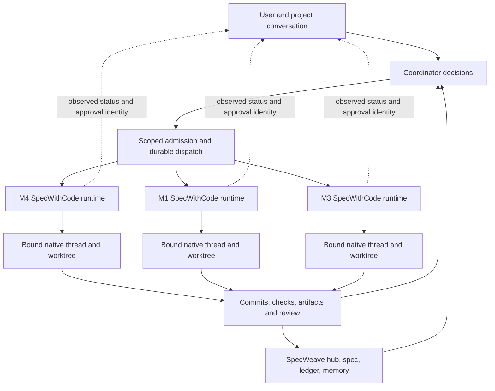

# Project orchestration

## Increment 0888 implementation

The project workspace retains a coordinator and opens existing worker chats beside it. Coordinator and worker provider/model choices remain independent. The worker pane uses its own containing block for native controls; ordinary full-page chats keep their existing title-bar layout.

### Coordinator recovery and response length

The main project conversation belongs to the coordinator. Opening a worker link or using a project new-chat shortcut keeps that conversation in place. Worker navigation never uses a different thread's cached transcript while loading.

The coordinator model picker remains available when its saved provider is unavailable. **Check again** refreshes that exact machine/profile and reports a failed check inline; it does not retry a turn. The picker also offers another model and host-scoped provider setup. Unsent coordinator text and attachments survive navigating to settings and back within the same window. A page reload or closing the window is not draft persistence.

Projects requiring restricted additional folder access use a Codex or Claude coordinator. Copilot can receive approved folder context when its existing native policy already grants Full access in Agent mode; selecting a model never broadens that policy. SpecWithCode checks the actual coordinator policy, explains incompatible choices and filters automatic fallback accordingly. Choosing a compatible model preserves the saved conversation and project folders. Provider failures retain SpecWithCode's specific folder-access reason instead of generic retry guidance.

**Retry last message** restores the last user-authored message, including screenshots and files, by re-staging its saved bytes on that message's host. Every attachment must be restored before dispatch. Unavailable or expired attachments ask for reattachment; attachment count and size failures show the message limits. These request errors do not report project-memory quotas.

An unconfirmed retry retains its request identity across navigation and reloads. Changed source-thread or model validation does not prove the earlier request was rejected. Only a host-confirmed attachment rejection before dispatch permits replacing the pending uploads. Retrying a completed failed turn uses a separate identity from the original send, including for text-only messages. If the conversation changes while restoring files, the pending retry cancels before dispatch.

The usage indicator is scoped to the selected execution machine/profile. A low percentage alone does not prove that an account can start work: native spend, workspace or account limits can still deny admission. Recovery estimates include every exhausted usage window and stay unknown when the provider does not supply enough information. Automatic recovery follows the configured policy and does not select paid API capacity automatically.

**Settings → Agents → Response style → Concise** is the default for short generated answers. It applies through the host/project settings, rather than a separate per-thread verbosity switch; the reply button in the project header sets it for the project. **Show** in the same menu, like **Appearance → Timeline detail**, changes how messages are displayed, not what the agent writes.

### Plans and task routing

Planning is optional. The **Plan** action opens a native spec, acceptance criteria, tasks, assignments and recorded evidence without installing or invoking SpecWeave. Reading an empty plan does not create one. Saving edits uses the displayed revision; a conflict preserves the draft. **Ask coordinator** sends the saved task ID through the same durable coordinator route. Agents can read the plan and claim, report or release their own assignments through project-bound MCP tools. They cannot configure authority, impersonate a human or invoke verification.

**Reported done** is distinct from **Verified**. The human verification action shows the saved executable, literal arguments, workspace and timeout before running it. It requires both orchestration-operation and terminal-operation permission. A command ID is durably reserved before execution, and retries return its receipt without running it twice. The UI retains an uncertain request ID across reloads and can recheck persisted evidence after local storage is lost. A new execution requires **New verification attempt**. Receipts show outcome, exit code, bounded output, output hash and definition revision. Changed definitions invalidate current verification while retaining historical evidence. This runner is not a sandbox; it executes the command the user requests on the selected host.

An explicit **Plan source** binding can instead read an existing SpecWeave increment. The configured root must resolve inside the project folder; use an umbrella-folder project when the ledger belongs above a child repository. Reads are bounded and reject malformed, missing or escaping sources. A separate metadata read keeps the binding and its revision available for explicit human repair when source reads fail; it never substitutes an empty plan. This mode creates no duplicate ledger, performs no CLI calls, and preserves external owners. External `done` is displayed as unverified. Exporting a native plan downloads `project-plan.md`; the export is not another authority.

The project workspace has no control that starts a thread. A thread is started by asking the coordinator, and the new-thread shortcut moves to the coordinator composer. A message typed in a worker pane goes straight to that worker, the way a thread outside a project takes it, with no coordinator turn. A worker on another machine still takes its messages through the coordinator; when the coordinator moves one to a different thread, the worker pane shows one line, "Moved to <thread>", under it.

Ordinary replies from the worker pane go through the coordinator, with the selected worker as a routing hint. The coordinator can continue it or choose another worker. Uploaded images and files follow the same route and appear in the coordinator conversation. Durable command receipts prevent duplicate delivery after an uncertain response, restart or expired upload staging. Native approval and question responses, and the reply to a worker's proposed plan (including **Implement plan**), stay with the worker that raised them; the coordinator never answers them for the user. Credit spending consent is valid only for an explicit direct submission to that same provider and model; project routing never transfers it.

Permanent project deletion removes project memory, plans, captured evidence, attachment bytes and routines while preserving source folders and remote Git branches. It requires the exact project name and refuses active work. Pausing and archiving are reversible. Both refuse new threads, delegation, coordinator turns and messages an agent sends to project threads; archive also refuses every project thread's next turn. A worker turn already running finishes rather than being cancelled. Pause, archive and auto-resume are user controls: an agent's `studio_project_update` call cannot change them. The coordinator thread cannot be archived or deleted on its own; archive or delete the project instead.

### Personal projects and execution environments

Projects remain provider-neutral. `kind: personal` creates an app-managed working folder without Git scaffolding; it uses the same coordinator, memory, plan, usage and routine services as code projects. Personal is not a grant to read the whole home directory or connect external accounts. In the product this kind is called a **Personal assistant**: the sidebar offers one until it exists, **New project** lists it beside a code project, and it starts with the display name Aide and its own icon, both of which the owner can change. Standalone Scratch chats remain available. Creation defaults to the current eligible machine, with an explicit host override. Connected remote hosts retain their own files, native sessions and credentials; a repository URL does not provision cloud execution.

#### The assistant routes work to the project that owns it

You can tell the personal assistant anything; work that belongs to another project goes there. Its coordinator calls `studio_route_targets`, which lists the projects whose folder is the assistant's own or inside one of its approved additional folders, with each one's goal, coordinator and latest threads (never its memory). It picks the owner from your words, its memory and that list, and asks one project choice only when two or more remain plausible. `studio_project_route` then hands your message, words and files unchanged, to that project's coordinator, starting it if needed; that coordinator reuses or starts its own workers. A request for several projects is routed once to each, with a one-line note naming that project's part, and the assistant answers with one link per project.

Routing never adds folders, connections or credentials: a project outside the approved folders, archived, paused or moved to another machine is refused with the reason, and you add the folder yourself in the assistant's settings. Each message reaches each project once, however often the call is retried, including after the staged copy of its files expired. A coordinator that runs in broader modes than the assistant's own conversation is refused. In the receiving coordinator the message reads as yours, with a "Routed by <assistant>" line. Projects on other machines are not routing targets yet.

The primary execution folder, additional approved folders and multiple repository URLs coexist in revisioned project settings. An additional approved folder cannot be the filesystem root, the home directory or an ancestor of it, or a credential or agent-state folder such as `~/.ssh`, `~/.aws`, `~/.config/gh`, `~/.claude`, `~/.codex` or `~/Library/Keychains`, because approval gives every native agent in the project read and write access. Saving a URL records intent only. **Match existing checkout** verifies the selected checkout and remote; **Prepare checkout** explicitly clones using host-owned Git authentication. Both reserve a durable command receipt before side effects, reject unsafe destinations and existing clone targets, and retain uncertain outcomes rather than automatically repeating an operation. Canonical folder identities are checked again at execution. Meaningful folder changes require active work and pending requests to finish or stop first. Paused and archived projects refuse preparation while still allowing ordinary settings edits.

Claude receives approved additional directories through its native SDK configuration; Codex receives them through workspace-write roots. A changed directory policy refreshes the retained native query. Other adapters reject additional-root requests until they can honor that policy. This extends the selected provider's existing permission mode; it does not claim to sandbox a provider running with unrestricted access.

Local repository authentication uses existing Git/SSH/credential-helper configuration. A SpecWithCode GitHub OAuth application is unnecessary for entering repository URLs and preparing local checkouts. A future hosted repository picker or installation integration would require a separately registered GitHub App and explicit account/repository grants.

### Project connections and durable context

Project connections currently use local MCP stdio servers on the execution host. Their revisioned records contain a command, literal arguments and environment-variable names, never credential values. Saving does not execute the command. The command must be an absolute path or a program name found on `PATH`, and arguments cannot be `./` or `../` paths, because the server runs unsandboxed in a folder agents can write; a relative script would let an agent change what runs on the next check or call. **Check connection** starts discovery; the user then explicitly grants individual discovered tools. Discovery means the server answered, not that every connected service permission was tested. These commands run as the host user and are not an OS sandbox. Remote HTTP/OAuth MCP setup is a separate capability. Read-only Gmail, Calendar and Drive come from the host's [Google account](google-account.md), which the person turns on per project.

The calling thread fixes the project scope for connection tools. Calls require an active project, current connection revision, an unchanged discovered tool definition, an explicit tool grant and write capability. A command receipt is reserved before the external call; uncertain outcomes cannot be silently replayed. Revocation clears grants and blocks subsequent calls. An already admitted call is bounded and finishes before a serialized pause, deletion or revocation; revocation cannot undo an external action. Project deletion purges connection configuration and call receipts while preserving external service data and local source folders. Referenced credential values are redacted before tool results are serialized, and external tool content cannot authorize further work.

Durable memory is project-scoped; provider session context and prompt caches remain provider-local. Context delivery prioritizes the project goal and user instructions before a bounded environment description and memory inventory, but always keeps at least 2,048 characters for `MEMORY.md`, so long instructions cannot hide project memory entirely. `MEMORY.md` is delivered inside a `<project_memory>` fence labelled as agent-written, possibly stale evidence; it cannot pose as user instructions, and after a Codex compaction it is restored as user-role context, never developer-role. The memory inventory lists whole file names and says how many more exist. Large location lists disclose truncation instead of consuming the instruction budget. Revision-aware delivery avoids appending unchanged complete memory on every turn; provider-native compaction stays with the provider. No cross-provider cache reuse or automatic memory merging is implied.

### Defaults when nothing is chosen

The project view does not show the goal above the conversation. Set or edit it under **Goal** in the project settings' General tab. Agents receive it with every turn's project context, and a project with no threads offers "Plan the first steps toward the goal" as a first task.

A project whose coordinator model was never picked starts on the host's default instead of refusing the first message: Opus 5.5 on a signed-in Claude subscription, otherwise that subscription's own default model, otherwise the default of the first other provider that can take a turn. A Claude instance billed per token is never chosen for you. The picker under the message box shows this model before the first message, and picking another one saves it for the project.

A new project started away from any project preselects a machine. With load balancing on, a **Manual only** machine is never picked for you, **Prefer** wins over **Normal** and **Less often**, and this computer breaks a tie. With it off, this computer is picked when it is eligible. The choice stays editable in the creation step, and a project you are already working in keeps its own machine.

### Limits

| Item                                 | Limit                                                                                                                       |
| ------------------------------------ | --------------------------------------------------------------------------------------------------------------------------- |
| Goal                                 | 8,000 characters                                                                                                            |
| Project instructions                 | 16,000 characters                                                                                                           |
| Delivered project context per prompt | 32,768 UTF-16 characters, with at least 2,048 kept for `MEMORY.md`                                                          |
| Memory                               | 256 KiB per file, 16 MiB and 4,096 files per project                                                                        |
| Project knowledge sent in full       | 24,000 characters of memory files and hub artifacts; above that the project switches to [search mode](project-knowledge.md) |
| Project knowledge index              | 2 MiB per file, 20,000 documents and 64 MiB of text per project                                                             |

### How SpecWithCode projects differ from Claude Code Projects

SpecWithCode projects follow the shape of [Claude Code Projects](https://code.claude.com/docs/en/claude-projects): one coordinating conversation, worker threads that report back, shared instructions and memory. These differences are deliberate or not yet closed:

|                                 | Claude Code Projects                                                                                    | SpecWithCode project workspaces                                                                                                                                                 |
| ------------------------------- | ------------------------------------------------------------------------------------------------------- | ------------------------------------------------------------------------------------------------------------------------------------------------------------------------------- |
| Providers                       | Anthropic models only, in cloud sessions or Remote Control                                              | Coordinator and workers each choose Claude, Codex or another configured provider                                                                                                |
| Where threads run               | Cloud sandbox per thread, or one folder on your computer through Remote Control                         | The host that owns the project folder; remote hosts keep their own files and credentials                                                                                        |
| Changed instructions and memory | Reach new threads only                                                                                  | Reach running threads as revision deltas on their next real prompt                                                                                                              |
| Memory for local threads        | Remote Control threads start without memory files                                                       | Every project thread, including the coordinator, receives the `MEMORY.md` index                                                                                                 |
| Writing in a worker             | Goes straight to that thread                                                                            | Ordinary replies go through the coordinator with the worker as a routing hint; approvals, questions and plan replies stay in the worker                                         |
| Worker checkout                 | Each cloud thread clones and works on its own branch                                                    | `delegate_task` workers share the coordinator's checkout and report back when done; `studio_thread_launch` with a worktree gives a separate branch but sends no completion back |
| Coordinator defaults            | Low effort coordinator, high effort threads, no connectors in the conversation                          | One coordinator model choice; the project worker default applies to workers. The coordinator is a full native session in the project folder                                     |
| Thread limits                   | 200 new threads per day enforced; concurrency preferences are soft                                      | No daily cap; concurrency preferences are soft                                                                                                                                  |
| Pause                           | Interrupts every running thread                                                                         | Refuses new work; a running worker turn finishes                                                                                                                                |
| Delete                          | Removes the project, threads, memory and files                                                          | Refuses while work is active; removes conversations, memory, plans and receipts, keeps folders and remote branches                                                              |
| Availability                    | Pro and Max beta at claude.ai/code, desktop and mobile; not the CLI, IDE extensions, Team or Enterprise | Private SpecWithCode build on your own machines                                                                                                                                 |

The following proposal is retained as historical research. Its mandatory SpecWeave-backed design was superseded by optional native planning in increment 0888. Release and native-provider acceptance remain separate from source integration.

## Original proposal (8 October 2026, superseded)

**Status: superseded by increment 0888. Statements below describe the code as of 8 October and are kept as history; the section above describes current behaviour.** Original status: proposed, 8 October 2026. Increment 0886 delivers output readability, quota recovery and private-fleet connections; it does not implement a persistent project coordinator. The source observations below were reviewed against `db1eb892` and `5470c02f`. Installed artifact and native-run evidence belong to the [operator guide](operator-guide.md), separately from this design.

**Add a project conversation above SpecWithCode’s existing sessions, backed by SpecWeave’s hub, spec, ledger and handoff. Keep the current environment-local project and thread identities.** SpecWithCode already has the execution primitives; it needs durable coordination, source-backed completion, and a clear interface for the user’s decisions.

A SpecWithCode project currently means a registered working folder on a particular environment. A Claude Project is an ongoing stream of work managed through a coordinating conversation. Changing the SpecWithCode sidebar label or grouping several chats would not bridge that difference. The useful product is a coordinator that can turn an authorized request into bounded work, find an existing owner, start isolated workers when appropriate, collect evidence, and return a decision the user can review.

## What the primary sources establish

Anthropic’s September 17 launch describes a coordinator that scopes work, delegates, reviews results and accumulates shared context. Its workers have separate branches and repository copies; overlapping changes can still require ordinary merge-conflict resolution. The launch announcement said local execution was forthcoming. That last point is now outdated. [Launch article](https://claude.com/blog/projects-redesigned).

Current Projects documentation describes a persistent coordinating conversation and independent worker sessions. The coordinator sees reports rather than every worker step. Cloud workers share repositories, instructions and memory; each reads `MEMORY.md` on startup. Local workers can now run through Remote Control: they inherit project instructions but do not start with project memory files loaded. Local execution needs an awake host. A manually started local session cannot simply be added to a Project. Existing cloud-session conversion can leave the original session running. Approvals must be answered inside the affected worker; a coordinator’s “go ahead” does not answer them. Stated concurrency preferences are instructions, not enforced caps. Coordinator and worker models/effort are separately configurable. Changes to project instructions, repositories, plugins, and environment apply to new workers, not ones already running. Projects remain a gradually rolled-out Pro/Max beta, and both workers and the coordinator consume plan capacity. [Current Projects documentation](https://code.claude.com/docs/en/claude-projects).

The broader agent documentation distinguishes persistent Projects from subagents that return to one session, agent teams for a coordinated assignment, and a view where the human dispatches separate sessions. Parallelism alone does not provide project coordination. [Agent comparison](https://code.claude.com/docs/en/agents).

Remote Control keeps filesystem access and execution on the selected computer. The browser or phone is a control surface, not a replacement host; local availability still depends on the host and Claude process. [Remote Control](https://code.claude.com/docs/en/remote-control).

## What SpecWithCode actually has

The following are source observations, not inferred live runtime state.

| Capability                   | Current implementation and implication                                                                                                                                                                                                                                                                                                                                                                                                                              |
| ---------------------------- | ------------------------------------------------------------------------------------------------------------------------------------------------------------------------------------------------------------------------------------------------------------------------------------------------------------------------------------------------------------------------------------------------------------------------------------------------------------------- |
| Environment-local project    | `OrchestrationProjectShell` contains a workspace root, repository identity, scripts and defaults. It has no project coordinator or shared goal field. [Contract](../../packages/contracts/src/orchestrationProject.ts#L9).                                                                                                                                                                                                                                          |
| Folder identity and grouping | Physical keys include environment plus normalized path; logical grouping can use repository identity. Grouping does not merge stores, permissions, owners or execution. [Grouping](../../packages/client-runtime/src/state/projectGrouping.ts#L69).                                                                                                                                                                                                                 |
| Bound worker conversation    | A thread stores its project, provider instance, model, runtime/interaction modes, branch, worktree and native thread identity. [Thread contract](../../packages/contracts/src/orchestrationV2.ts#L341).                                                                                                                                                                                                                                                             |
| Isolated execution           | `ThreadLaunchService` takes an explicit workspace strategy and starts setup in the selected worktree or project root. A prompt containing `cd` does not change that binding. [Launch input](../../apps/server/src/orchestration-v2/ThreadLaunchService.ts#L74), [chosen cwd](../../apps/server/src/orchestration-v2/ThreadLaunchService.ts#L470).                                                                                                                   |
| Delegation and scheduling    | SpecWithCode already distinguishes child delegated work, ordinary top-level chats, and persistent schedules. It documents stable client request IDs for delegated rounds and warns that `studio_thread_launch` lacks a public idempotency key. [Native orchestration instructions](../../apps/server/src/provider/StudioOrchestrationInstructions.ts#L8).                                                                                                           |
| Observation and attention    | Overview derives shell status and approval/input/plan/limit/failure attention. Disconnected environments retain last-observed labels and do not claim current activity. Opening a new session creates a draft; the user starts it. [Projection](../../apps/web/src/studio/overviewModel.ts#L34), [draft behavior](../../apps/web/src/components/studio/StudioOverview.tsx#L95).                                                                                     |
| Native goal                  | SpecWithCode mirrors a provider thread’s native goal and provider-specific usage. That state does not establish project acceptance or a fleet-wide coordinator. [Goal contract](../../packages/contracts/src/orchestrationV2.ts#L829).                                                                                                                                                                                                                              |
| Portable project intent      | The existing SpecWeave project hub stores goal, context, artifacts and routines in `.specweave/project/hub.json` under the canonical project root. The increment’s `spec.md` and append-only `ledger.jsonl` carry acceptance criteria, ownership and evidence. Resolve these from the selected project’s verified SpecWeave root; they are not a new SpecWithCode-global ledger. See the [handoff guidance](operator-guide.md#how-to-send-work-to-another-machine). |

## Proposed coordinator window

Make it an optional project-level surface. Its main pane is the project conversation. Beside it, show the work that needs a decision first, then active work and verified results. Each card carries the actual host, account/provider, task, workspace, last observation and evidence link. Opening a card opens the existing worker. A model-written sentence cannot overwrite an authoritative task or runtime state.

Keep three independent state axes: task acceptance (`planned`, `claimed`, `verification pending`, `done`); observed execution (`running`, `waiting`, `stopped`, `unknown`); and attention (`approval`, `input`, `quota`, `conflict`, `review`). A task may be claimed while its host is unreachable; a completed model turn may still need tests. A single green status would conceal both distinctions.

A minimum binding should identify the portable project, canonical SpecWeave root, coordinator thread and environment, explicitly linked environment-local projects, current coordinator ownership epoch, and user-approved dispatch policy. A separate runtime dispatch receipt maps an increment/task and attempt to its actual thread, provider instance, worktree, command ID, source revision and outcome. These are runtime bindings and receipts, not a second task ledger.

The coordinator can answer ordinary questions without launching workers. For actionable requests, it first reconciles the current hub revision, task ownership and live sessions. It routes a follow-up to the existing owner only when authorized. It proposes or starts new work according to the user’s granted scope, reserves the task, chooses a compatible verified environment, creates an isolated checkout, and records the accepted thread before retrying anything. It uses worker outcomes to request verification; only successful checks and the required review satisfy the SpecWeave task.

## Correctness boundaries

**One active coordinator per project scope.** Use a durable lease with a monotonically increasing epoch, checked on every dispatch by the admission service. A disconnected or expired coordinator becomes unable to admit new work. Its workers do not become available for takeover merely because a timer elapsed. A replacement coordinator reconciles existing dispatch receipts and owners before it can launch replacements. This permits observation during a network partition without turning uncertainty into duplicate mutation.

**Idempotence before retries.** Persist the dispatch intent before the provider call and retain the returned native/SpecWithCode identities. A lost response is “acceptance unknown”; inspect the durable receipt or thread listing. Do not blindly repeat a non-idempotent launch. Use stable client request IDs for delegated attempts. A deliberate second review gets a new attempt ID, while transport retries retain the old one.

**Account affinity.** Bind a worker to its environment, provider instance and verified account identity for its lifetime. Capacity on another subscription can inform a new independent task, but cannot silently move an existing conversation. Arm recovery against the original identity and recheck actual ordinary usage permission. Unknown quota, stale identity and a credit balance are not dispatch permission. Never sync OAuth material, account folders or provider databases to make the UI appear continuous.

**Approvals stay attached to the action.** Aggregate a pending approval as a reference to its environment, thread, native request ID, scope and current revision. The selected destination must revalidate it at execution. A project-level reply can navigate to the correct approval, but must not turn into blanket permission or answer a different request after refresh. Changing a coordinator model or reconnecting a Mac grants no additional authority.

**Cross-Mac continuity uses portable state.** Sync commits, reviewed patches, specs, handoffs and artifact manifests. Each Mac keeps its own checkout, SQLite store, provider home and credentials. A continuation records exact repository, branch, commit, worktree, task, owner, evidence and next step. It requires the old writer’s acknowledged handoff or an explicit operator resolution; an offline host is an observation gap. Network reachability and app pairing remain distinct requirements.

**Concurrent memory is a merge problem.** Store each durable fact in its own file with provenance, author, source revision and time. Use compare-and-swap on a known base revision for shared indexes. Preserve both updates on conflict; contradictory facts become an explicit decision with supporting evidence. Do not let an LLM’s rewritten summary erase a worker’s finding. The existing context-sync branch stays a context transport and must never merge into product code. Memory loading is recorded per dispatch, so the coordinator can identify workers that started before a changed instruction.

**Admission is code.** The coordinator proposes a plan, but a deterministic service checks host availability, current ownership, worktree uniqueness, account binding, scope and a hard concurrency budget. Route/classifier suggestions may assist selection; they must not authorize execution. Avoid claiming that a prose instruction or a visible quota gauge enforces these boundaries.

**Observe cheaply and wake intentionally.** Use persisted runtime events and bounded shell projections, not repeated full transcript hydration. Persist event cursors and deduplicate coordinator wakeups. A finished worker or a meaningful blocker may trigger one coordinator turn. Unchanged idle state should not consume repeated model turns. Schedules are opt-in actions and must retain their destination and notification policy.

## Provider cloud tasks are out of scope

SpecWithCode does not dispatch work to provider cloud sessions or cloud tasks. Off-machine work runs on a Linux VPS you rent, joined to your tailnet as one of your private machines; see [Linux worker](../user/linux-worker.md). A coordinator still displays which machine owns the work and verifies destination permissions there.

## Delivery sequence and proof

First ship a read-only Project Overview that binds the hub to existing sessions and makes ownership, freshness and evidence legible. Then add an explicitly selected coordinator conversation with narrowly scoped dispatch and receipts. Introduce cross-host admissions only after local crash/retry proof. Add automatic wakeups and routines after duplicate suppression and recovery are demonstrated.

The decisive integration test is two real worker chats on two isolated worktrees, with one project task each, while preserving an already active unrelated chat. Show the exact provider/account/workspace binding, actual response, retained transcript and task evidence. Then replay a lost launch response, coordinator restart, stale approval, unavailable account, disconnected host, overlapping file scope and concurrent memory update. Each must refuse or reconcile without duplicate execution. A fixture can prove guards; it cannot prove authenticated subscription capacity or live native continuity.

For the 0886 implementation, the optimized-Python restart bypass is fixed and independently exercised with 41 synthetic guard/recovery tests. That review does not authorize a restart of an active service. Current-account eligibility, live multi-chat execution and the installation/readback chain require separate evidence. [Updates](updates.md) describes the installed update receipt; the proposed coordinator still requires its own implementation and acceptance checks.
